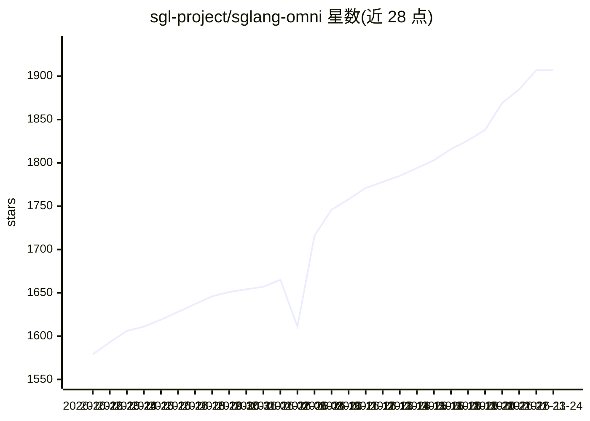

# sgl-project/sglang-omni

⭐ 1,922 · Python · Apache-2.0 · 推送 2026-11-24 · [GitHub](https://github.com/sgl-project/sglang-omni) · [官网](https://sgl-project.github.io/sglang-omni/) · 组织维护 · 中文 README

**多阶段多模态与语音模型服务运行时：统一托管 TTS/ASR/全双工**

面向 omni、语音与 TTS 模型的多阶段服务运行时：将生成建模为预处理、编码器、自回归引擎、talker、解码器、声码器等协同阶段，按阶段匹配调度器，通过共享内存、NCCL、NIXL、Mooncake 等后端传输张量，并对外提供 OpenAI 兼容端点（多模态聊天、语音生成、转录、实时全双工）。硬件支持 NVIDIA CUDA（默认）、Intel XPU 与实验性 Apple Silicon。以 PyPI 包发布，与 SGLang 组合完成自回归调度与模型执行。

## 筛选速览

| 维度 | 判定 | 备注 |
|---|---|---|
| AI 角色 | `ai-ecosystem` | LLM/agent 周边工具 |
| 许可风险 | `permissive` | Apache-2.0 |
| 部署形态 | `library` | 以包/库形式分发 |
| 模型依赖 | — | README 未给出锁定关系 |
| 硬件要求 | — | 无带数字的原话,不猜 |
| 安装摩擦 | `medium` | 含编译或系统依赖之一 |
| 成熟度 | — | 结构信号不足 |

## 能力要点

- 多阶段运行时：统一管理管道拓扑、阶段生命周期与阶段间传输
- OpenAI 兼容端点覆盖多模态聊天、语音生成、批量/流式语音与转录
- 级联语音助手：ASR→LLM→TTS 组合为流式回合对话
- CUDA 默认后端，支持 Intel XPU 与实验性 Apple Silicon

## 适用场景

- 为语音助手部署 ASR、LLM、TTS 的流式级联服务
- 以统一运行时托管多种 TTS 与全双工对话模型
- 通过 OpenAI 兼容接口提供音频转录与说话人分离服务

## 场景标签

`语音 Agent` `语音合成` `语音识别` `推理引擎` · 领域:对话与助手

## 证据(README 行号)

> L38: SGLang-Omni is a multi-stage serving runtime for omni, speech, and TTS models. Its design target is multi-stage dec
> L43: - **API surface**: OpenAI-compatible endpoints expose multimodal chat, speech generation, batch speech, streaming s
> L58: ## Hardware Support

## 星数曲线

2026-10-22 1,579 → 2026-11-24 1,907（+328）

---
*卡片 v1 · prompt 1.4 · 生成 2026-11-24 · 置信度 high · 依据 README sha `7be246badec2` · [字段定义](../../DATASET.md)*
