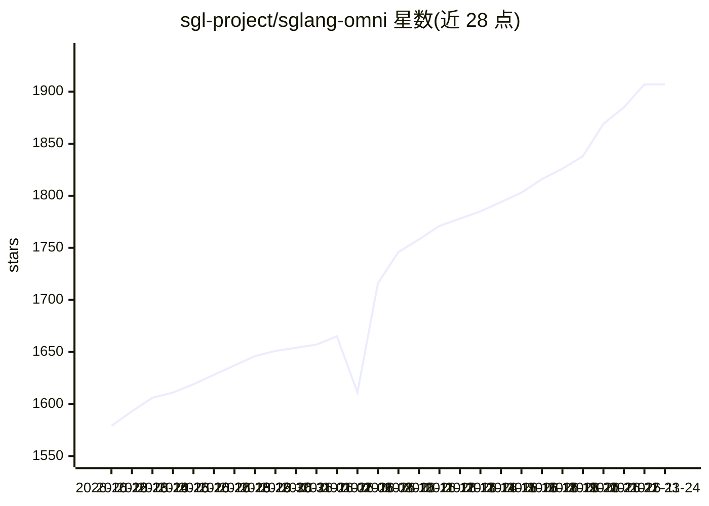

# sgl-project/sglang-omni

⭐ 1,907 · Python · Apache-2.0 · 推送 2026-11-22 · [GitHub](https://github.com/sgl-project/sglang-omni) · [官网](https://sgl-project.github.io/sglang-omni/) · 组织维护

**面向语音/全模态模型的多阶段高性能推理服务运行时**

SGLang-Omni 是一个多阶段服务运行时，用于部署 omni、语音与 TTS 模型：将生成过程拆分为预处理、编码器、自回归引擎、talker、解码器、声码器等阶段，由各阶段专属调度器协调，并通过共享内存、NCCL、NIXL、Mooncake 等后端传输张量数据。对外提供 OpenAI 兼容端点，覆盖多模态对话、全双工实时会话、TTS、ASR 转写、说话人分离、语音翻译与音乐生成。需要时可与 SGLang 组合完成自回归调度与模型执行。支持 NVIDIA CUDA（默认）、Intel GPU 与实验性的 Apple Silicon。

## 筛选速览

| 维度 | 判定 | 备注 |
|---|---|---|
| AI 角色 | `ai-ecosystem` | LLM/agent 周边工具 |
| 许可风险 | `permissive` | Apache-2.0 |
| 部署形态 | `library` | 以包/库形式分发 |
| 模型依赖 | — | README 未给出锁定关系 |
| 硬件要求 | — | 无带数字的原话,不猜 |
| 安装摩擦 | `medium` | 含编译或系统依赖之一 |
| 成熟度 | — | 结构信号不足 |

## 能力要点

- 多阶段运行时：管线拓扑、阶段生命周期与跨阶段传输管理
- OpenAI 兼容端点覆盖聊天、TTS、ASR、实时语音等接口
- 支持 CUDA、Intel XPU 与实验性 Apple Silicon 后端
- 级联语音助手：ASR→LLM→TTS 组合为流式对话

## 适用场景

- 部署 Qwen3-Omni、MiniCPM-o 等全模态模型的推理服务
- 搭建支持打断与轮次切换的实时语音助手
- 提供批量与流式 TTS、ASR 转写 API 服务
- 在 Intel Arc GPU 上端到端运行语音模型

## 场景标签

`语音 Agent` `语音合成` `语音识别` · 领域:对话与助手

## 证据(README 行号)

> L38: SGLang-Omni is a multi-stage serving runtime for omni, speech, and TTS models. Its design target is multi-stage dec
> L43: - **API surface**: OpenAI-compatible endpoints expose multimodal chat, speech generation, batch speech, streaming s

## 星数曲线

2026-10-22 1,579 → 2026-11-24 1,907（+328）

---
*卡片 v1 · prompt 1.4 · 生成 2026-11-23 · 置信度 high · 依据 README sha `84f6f58b6113` · [字段定义](../../DATASET.md)*
