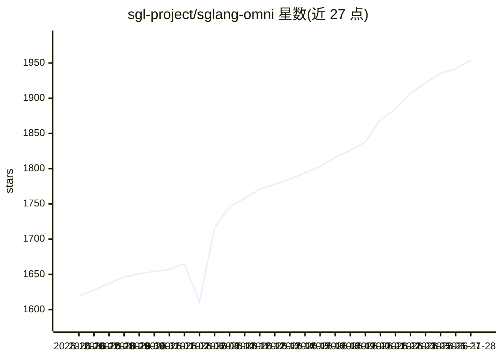

# sgl-project/sglang-omni

⭐ 1,954 · Python · Apache-2.0 · 推送 2026-11-27 · [GitHub](https://github.com/sgl-project/sglang-omni) · [官网](https://sgl-project.github.io/sglang-omni/) · 组织维护 · 中文 README

**面向多模态与语音模型的多阶段高性能推理服务运行时**

SGLang-Omni 是针对 omni、语音与 TTS 模型的多阶段服务运行时，将生成过程拆分为预处理、编码器、自回归引擎、talker、解码器、vocoder 等阶段并分别调度，控制面协调请求，数据面经共享内存、NCCL、NIXL、Mooncake 等后端传输张量。提供 OpenAI 兼容端点覆盖多模态对话、语音生成、批量/流式语音与转录。默认后端为 NVIDIA CUDA，Apple Silicon 为实验性支持，Intel XPU 支持列表内模型端到端运行。面向部署与集成此类模型的开发者。

## 筛选速览

| 维度 | 判定 | 备注 |
|---|---|---|
| AI 角色 | `ai-ecosystem` | LLM/agent 周边工具 |
| 许可风险 | `permissive` | Apache-2.0 |
| 部署形态 | `library` | 以包/库形式分发 |
| 模型依赖 | — | README 未给出锁定关系 |
| 硬件要求 | — | 无带数字的原话,不猜 |
| 安装摩擦 | `medium` | 含编译或系统依赖之一 |
| 成熟度 | — | 结构信号不足 |

## 能力要点

- 多阶段运行时：按阶段专用调度器协调预处理、编码、自回归、vocoder 等
- 传输感知执行：共享内存、NCCL、NIXL、Mooncake 多后端数据面
- OpenAI 兼容端点：多模态对话、语音生成、转录、说话人分离等
- 支持 CUDA（默认）、Apple Silicon（实验性）与 Intel XPU 后端

## 适用场景

- 部署 Qwen3-Omni 等全双工多模态对话服务
- 搭建 ASR → LLM → TTS 的级联流式语音助手
- 托管 TTS 模型提供批量与流式语音生成 API
- 提供语音转录与说话人分离服务

## 场景标签

`推理引擎` `语音合成` `语音识别` `多模态` · 领域:内容生成

## 证据(README 行号)

> L38: SGLang-Omni is a multi-stage serving runtime for omni, speech, and TTS models. Its design target is multi-stage dec
> L43: - **API surface**: OpenAI-compatible endpoints expose multimodal chat, speech generation, batch speech, streaming s

## 星数曲线

2026-10-26 1,619 → 2026-11-28 1,954（+335）

---
*卡片 v1 · prompt 1.4 · 生成 2026-11-27 · 置信度 high · 依据 README sha `3fef0f0e0d60` · [字段定义](../../DATASET.md)*
