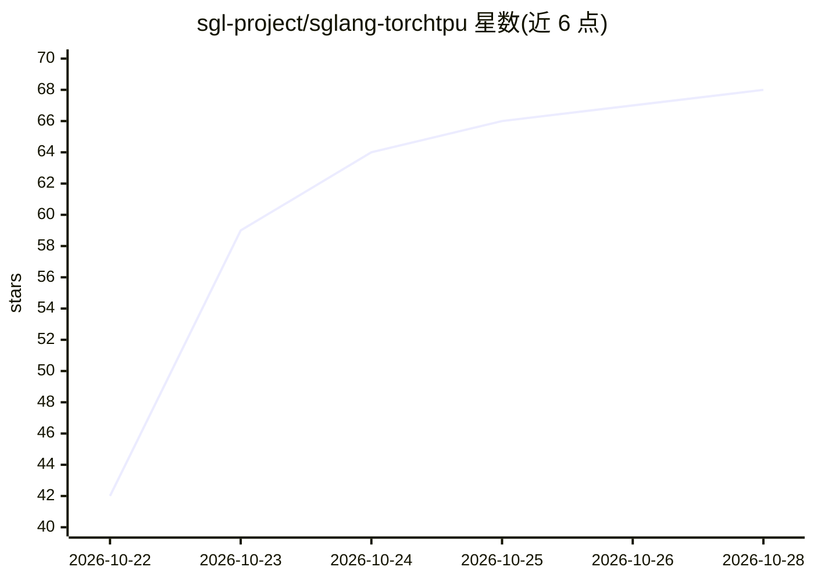

# sgl-project/sglang-torchtpu

⭐ 68 · Python · Apache-2.0 · 推送 2026-10-27 · [GitHub](https://github.com/sgl-project/sglang-torchtpu) · 组织维护

**SGLang 的 PyTorch 原生 TPU 推理服务后端插件**

sgl-project 维护的 SGLang 生态组件：通过 torch_tpu 与 Pallas 内核把 SGLang 服务引擎带到 Google TPU7x（Ironwood）上，提供 OpenAI 兼容 API，支持 eager 执行与 TPU 编译。特性包括张量/专家/数据/流水线/上下文并行、前缀缓存、KV offload、分离式 prefill/decode、FP8/MXFP4/INT4 低精度推理及 EAGLE3 等投机解码。模型覆盖 GPT-OSS、DeepSeek、Qwen、Gemma 等，部分为实验性集成。仅面向 TPU 硬件，需 Linux x86_64 与 Python 3.11-3.14。

## 筛选速览

| 维度 | 判定 | 备注 |
|---|---|---|
| AI 角色 | `ai-ecosystem` | LLM/agent 周边工具 |
| 许可风险 | `permissive` | Apache-2.0 |
| 部署形态 | `self-host` | docker 或自建部署 |
| 模型依赖 | — | README 未给出锁定关系 |
| 硬件要求 | — | 无带数字的原话,不猜 |
| 安装摩擦 | `low` | 无编译、无系统依赖或容器化 |
| 成熟度 | — | 结构信号不足 |

## 能力要点

- 通过 torch_tpu + Pallas 内核在 TPU7x 上运行 SGLang 服务引擎
- OpenAI 兼容 API，支持多种并行策略与分离式 prefill/decode
- FP8/MXFP4/INT4 W4A16 低精度推理与 FP8 KV cache
- 支持 EAGLE3、MTP 等投机解码方案

## 适用场景

- 在 TPU7x 集群上部署 LLM/VLM 推理服务
- 用 PyTorch 工作流开发并编译 TPU serving 配置
- 以 OpenAI 兼容客户端接入 SGLang TPU 后端

## 场景标签

`推理引擎` · 领域:训练与推理

## 证据(README 行号)

> L5:  PyTorch-native LLM serving on Google TPUs.
> L11: SGLang-TorchTPU brings SGLang to Google TPUs through **torch_tpu** and **Pallas kernels**. Serve large language and

## 星数曲线

2026-10-22 42 → 2026-10-28 68（+26）

---
*卡片 v1 · prompt 1.4 · 生成 2026-10-24 · 置信度 high · 依据 README sha `c36b0dd9d68e` · [字段定义](../../DATASET.md)*
