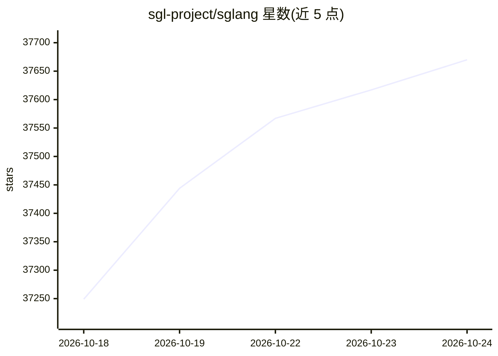

# sgl-project/sglang

⭐ 37,670 · Python · Apache-2.0 · 推送 2026-10-23 · [GitHub](https://github.com/sgl-project/sglang) · [官网](https://sglang.io) · 组织维护

**面向开发者的大模型与多模态模型推理服务框架**

开源推理框架，支持大语言模型、视觉语言模型与扩散模型的部署服务，面向 agentic 工作负载、大规模服务与 RL rollout 场景进行优化。仓库内置 SGLang Diffusion 图像与视频生成引擎，并通过 SGLang Omni 提供语音模型的 TTS/ASR 服务。通过 Docker 镜像或 uv/pip 从 PyPI 安装；开发环境提供 dev 镜像与可编辑安装方式。项目由 LMSYS 托管，覆盖 GPU、TPU、NPU、CPU 及 Apple Silicon 多类平台。

## 筛选速览

| 维度 | 判定 | 备注 |
|---|---|---|
| AI 角色 | `ai-native` | 本体是模型或模型工具 |
| 许可风险 | `permissive` | Apache-2.0 |
| 部署形态 | `self-host` | docker 或自建部署 |
| 模型依赖 | — | README 未给出锁定关系 |
| 硬件要求 | — | 无带数字的原话,不猜 |
| 安装摩擦 | `low` | 无编译、无系统依赖或容器化 |
| 成熟度 | — | 结构信号不足 |

## 动量与使用信号

- 维护:`active` — 距上次 push 0.6 天,年发版 33,448 位贡献者
- 涨星:近 1 天 **+43**(自 20261016 起算)
- 安装:pypi 包 `sglang` 月下载 2,984,581

## 能力要点

- 支持大语言、视觉语言与扩散模型的服务
- 内置 SGLang Diffusion 图像与视频生成引擎
- 覆盖 NVIDIA/AMD/TPU/Intel/Apple Silicon/昇腾/摩尔线程等硬件平台
- 生态包含 SpecForge 投机解码与多个 RL 训练框架集成

## 适用场景

- 为大模型应用搭建推理服务后端
- 在国产 NPU 或多类加速硬件上部署模型
- 运行图像与视频生成模型服务
- RL 训练流程中的 rollout 生成

## 场景标签

`推理引擎` `强化学习` · 领域:训练与推理

## 证据(README 行号)

> L15: SGLang is an open-source inference framework for large language, vision-language, and diffusion models, optimized f
> L40: SGLang supports a wide range of GPUs, TPUs, NPUs, CPUs, and Apple Silicon platforms.

## 星数曲线

2026-10-18 37,249 → 2026-10-24 37,670（+421）

---
*卡片 v1 · prompt 1.4 · 生成 2026-10-18 · 置信度 high · 依据 README sha `3b52f2ed0651` · [字段定义](../../DATASET.md)*
