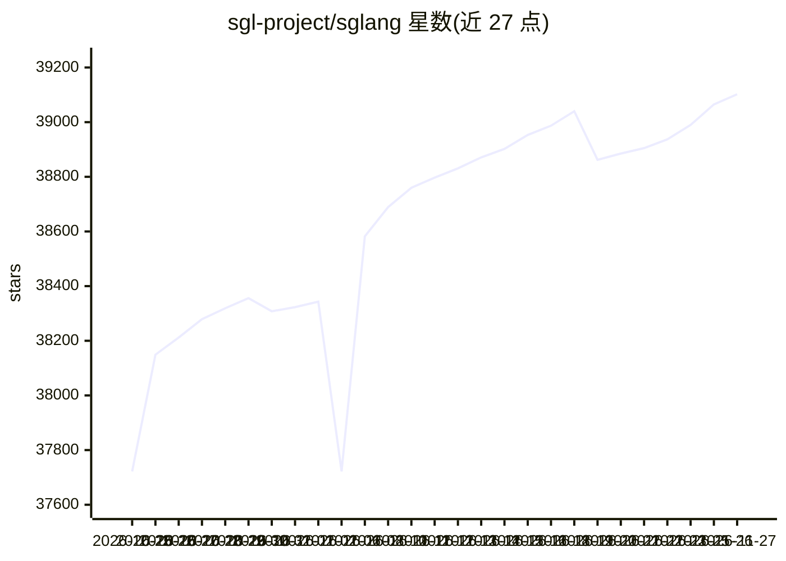

# sgl-project/sglang

⭐ 39,102 · Python · Apache-2.0 · 推送 2026-11-26 · [GitHub](https://github.com/sgl-project/sglang) · [官网](https://sglang.io) · 组织维护

**面向 LLM/多模态模型的推理服务框架**

开源推理框架，覆盖大语言模型、视觉语言模型与扩散模型，面向 agentic 工作负载、大规模服务与 RL rollout 场景优化。内置 SGLang Diffusion 引擎支持图像、视频、音频与动作生成；SGLang Omni 提供语音模型服务（TTS/ASR）。通过 Docker 镜像或 Python 包安装，支持 NVIDIA、AMD、TPU、Apple Silicon、华为昇腾等多类硬件平台，由 LMSYS 托管维护。

## 筛选速览

| 维度 | 判定 | 备注 |
|---|---|---|
| AI 角色 | `ai-ecosystem` | LLM/agent 周边工具 |
| 许可风险 | `permissive` | Apache-2.0 |
| 部署形态 | `self-host` | docker 或自建部署 |
| 模型依赖 | — | README 未给出锁定关系 |
| 硬件要求 | — | 无带数字的原话,不猜 |
| 安装摩擦 | `low` | 无编译、无系统依赖或容器化 |
| 成熟度 | — | 结构信号不足 |

## 动量与使用信号

- 维护:`active` — 距上次 push 0.6 天,年发版 33,448 位贡献者
- 涨星:近 1 天 **+43**(自 20261016 起算)
- 安装:pypi 包 `sglang` 月下载 2,984,581

## 能力要点

- 支持 LLM、视觉语言与扩散模型的服务
- 内置 SGLang Diffusion：图像/视频/音频/动作生成引擎
- 覆盖 NVIDIA/AMD/TPU/Intel/Apple Silicon/昇腾等多平台硬件
- 配套生态：SpecForge 投机解码训练、多个 RL 框架集成 rollout

## 适用场景

- 部署大语言模型推理服务并进行路由与负载均衡扩展
- 为 RL 训练框架提供 rollout 生成
- 在多种加速硬件上运行多模态模型推理

## 场景标签

`推理引擎` `图像生成` `强化学习` · 领域:内容生成

## 证据(README 行号)

> L15: SGLang is an open-source inference framework for large language, vision-language, and diffusion models, optimized f
> L71: |Deployment and Orchestration|RBG, llm-d, Ray Serve, NVIDIA Dynamo|Deploy and scale SGLang inference services with 

## 星数曲线

2026-10-25 37,722 → 2026-11-27 39,102（+1,380）

---
*卡片 v1 · prompt 1.4 · 生成 2026-11-22 · 置信度 high · 依据 README sha `7b709aa6b900` · [字段定义](../../DATASET.md)*
