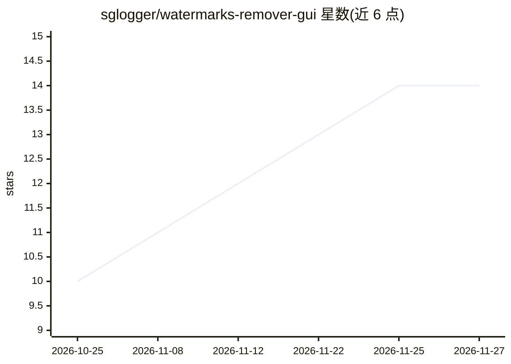

# sglogger/watermarks-remover-gui

⭐ 14 · Python · NOASSERTION · 推送 2026-09-07 · [GitHub](https://github.com/sglogger/watermarks-remover-gui) · 个人维护

**检测并清除文本/文档/图像中 AI 水印痕迹的网页前端**

为 watermarks-remover 引擎提供的 Web 前端，自身不含引擎代码，通过运行引擎官方容器镜像并调用其 HTTP API 工作。提供文本页（逐个标出不可见字符并清除）与文件页（一次最多 25 个文件、逐文件判定、打包 ZIP 下载清洁副本），每次清除后回送引擎复检并如实报告。可检测零宽字符、不可见 Unicode、C2PA 清单、EXIF/XMP 等 AI 出处元数据；纯文本的统计水印清除需额外配置改写后端（如 Ollama）。音频视频被刻意排除。部署只需 Docker Compose。

## 筛选速览

| 维度 | 判定 | 备注 |
|---|---|---|
| AI 角色 | `ai-native` | 本体是模型或模型工具 |
| 许可风险 | `none` | NOASSERTION |
| 部署形态 | `desktop` | 安装包/桌面程序 |
| 模型依赖 | local-ok | 支持本地模型 |
| 硬件要求 | — | 无带数字的原话,不猜 |
| 安装摩擦 | `low` | 无编译、无系统依赖或容器化 |
| 成熟度 | — | 结构信号不足 |

## 能力要点

- 文本与文件两种检测入口，最多一次处理 25 个文件并支持 ZIP 下载
- 清除结果回送引擎复验，报告中如实标注未清除项
- 检测不可见 Unicode 载体与 C2PA/EXIF/XMP 等 AI 出处元数据
- 上传仅驻留内存十分钟，容器以只读文件系统运行

## 适用场景

- 清除文档中的零宽字符等隐藏痕迹后再分发
- 检查 AI 生成图像的 C2PA/元数据标记并清除
- 本地自托管实例处理涉密文档

## 场景标签

 · 领域:隐私/内容安全工具

## 证据(README 行号)

> L3: A small, responsive web frontend for finding and removing AI provenance marks in
> L33: This repository is an independent frontend. It contains **none** of the engine's
> L240: ## Quick start

## 星数曲线

2026-10-25 10 → 2026-11-27 14（+4）

---
*卡片 v1 · prompt 1.4 · 生成 2026-11-18 · 置信度 mid · 依据 README sha `6f49f2e124f4` · [字段定义](../../DATASET.md)*
