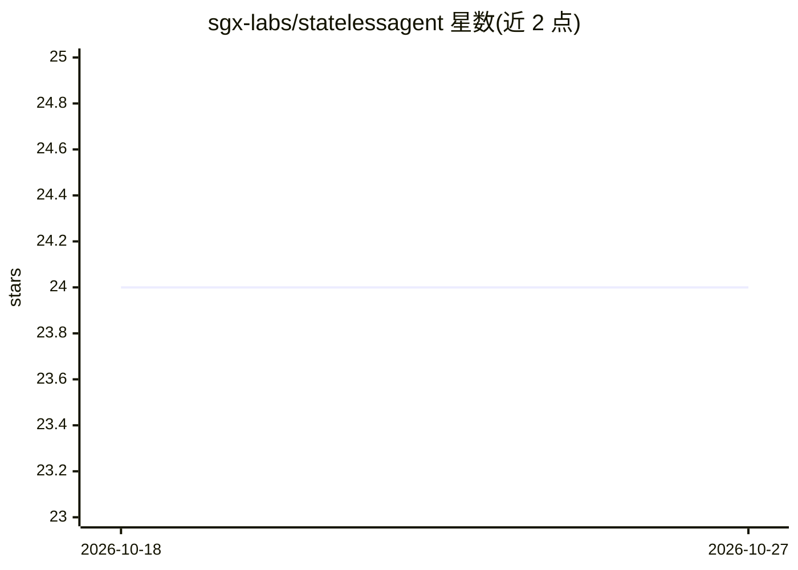

# sgx-labs/statelessagent

⭐ 24 · Go · NOASSERTION · 推送 2026-10-15 · [GitHub](https://github.com/sgx-labs/statelessagent) · [官网](https://statelessagent.com) · 组织维护

**给 AI 编程工具的本地持久记忆层：单二进制 MCP 服务**

用 Go 编写的单二进制工具（约 14MB），为 Claude Code、Cursor、Windsurf、Codex CLI、Gemini CLI 等 AI 编程工具提供跨会话持久记忆：索引 markdown 笔记为嵌入存入 SQLite，通过 hooks 或 19 个 MCP 工具在会话启动时自动呈现相关上下文，记录决策与交接（handoff）。双层记忆经 LLM 从笔记抽取原子事实，含出处追踪与过期标记；无外部依赖时回退 SQLite FTS5 关键词搜索，接入 Ollama 后可语义检索。内置 PII 扫描、推送保护与三级隐私目录；提供 17 个预置知识库（870+ 笔记）。数据全程本地、无遥测，支持 Mac/Linux/Windows/树莓派。许可为 BSL 1.1，2030 年转 Apache 2.0。

## 筛选速览

| 维度 | 判定 | 备注 |
|---|---|---|
| AI 角色 | `ai-ecosystem` | LLM/agent 周边工具 |
| 许可风险 | `none` | NOASSERTION |
| 部署形态 | `self-host` | docker 或自建部署 |
| 模型依赖 | local-ok | 支持本地模型 |
| 硬件要求 | — | 无带数字的原话,不猜 |
| 安装摩擦 | `low` | 无编译、无系统依赖或容器化 |
| 成熟度 | — | 结构信号不足 |

## 能力要点

- 单二进制全本地运行，无外部依赖（关键词回退），接入 Ollama 可语义检索
- 19 个 MCP 工具，适配 Claude Code/Cursor/Windsurf 等 AI 编程工具
- 双层记忆：LLM 抽取原子事实 + 笔记出处追踪与过期标记
- PII 扫描、多 agent 文件认领与三级隐私目录

## 适用场景

- 让 AI 编程助手跨会话记住项目决策与上下文
- 在 Claude Code 与 Cursor 等工具间共享同一份记忆
- 把 Obsidian/markdown 笔记作为 AI 检索的知识库

## 场景标签

`Agent 记忆` · 领域:Agent 开发

## 证据(README 行号)

> L12: SAME gives every AI coding tool persistent memory. Claude Code, Cursor, Windsurf, Codex CLI, Gemini CLI — one memor
> L64: - **Works with your tools** -- 19 MCP tools for Claude Code, Cursor, Windsurf, or any MCP client. Search, save deci
> L89: Your Notes (.md)  -->  Embeddings  -->  SQLite  -->  Your AI Tool

## 星数曲线

2026-10-18 24 → 2026-10-27 24（+0）

---
*卡片 v1 · prompt 1.4 · 生成 2026-10-27 · 置信度 high · 依据 README sha `04fd93726c1e` · [字段定义](../../DATASET.md)*
