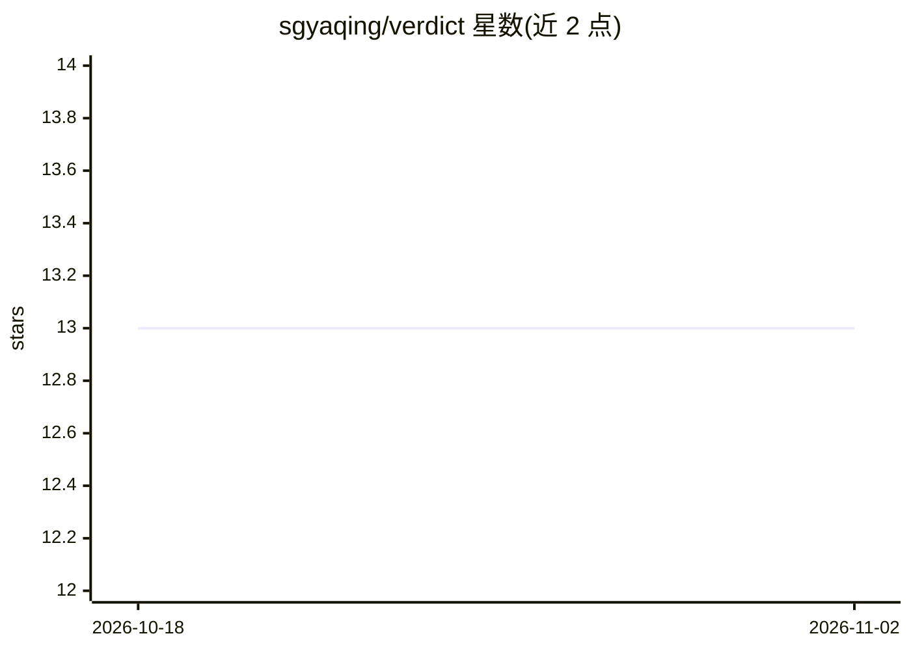

# sgyaqing/verdict

⭐ 13 · Rust · Apache-2.0 · 推送 2026-10-26 · [GitHub](https://github.com/sgyaqing/verdict) · 个人维护 · 中文 README

**面向开发者的 System One 决策模型推理服务引擎**

Verdict 是一个为 System One 决策模型提供的高性能推理服务引擎，以 Docker 或 CLI（verdict serve）方式运行，支持 OneJev1.6、decider-2b、von、laya-multilingual、laya 五个模型包（含变体家族 :variant 选尺寸）。提供 /v1/systemone、OpenAI Decisions 协议的 /v1/decisions、单问题端点（choice/score/noul）以及 OpenAI 兼容的 /v1/chat/completions 层，支持文本、图像与视频输入（视频仅 /v1/systemone），并输出 Prometheus 指标。模型可从 Hugging Face 或 ModelScope 拉取。README 限制：性能对比基于作者自有服务器数据；GPU 用于基准测试环境。

## 筛选速览

| 维度 | 判定 | 备注 |
|---|---|---|
| AI 角色 | `ai-ecosystem` | LLM/agent 周边工具 |
| 许可风险 | `permissive` | Apache-2.0 |
| 部署形态 | `self-host` | docker 或自建部署 |
| 模型依赖 | — | README 未给出锁定关系 |
| 硬件要求 | — | 无带数字的原话,不猜 |
| 安装摩擦 | `low` | 无编译、无系统依赖或容器化 |
| 成熟度 | — | 结构信号不足 |

## 能力要点

- 一条命令 serve 五个决策模型包，支持 :variant 变体家族选尺寸
- 同时提供 System One 原生 API、OpenAI Decisions 协议与 OpenAI 兼容层
- 支持文本/图像/视频输入与 Prometheus /metrics 端点
- 模型源可在 Hugging Face 与 ModelScope 间切换（VERDICT_USE_MODELSCOPE=1）

## 适用场景

- 本地或私有环境部署 System One 决策模型推理服务
- 用现有 OpenAI SDK 直接调用决策端点
- 为决策类模型服务接入 Prometheus 监控

## 场景标签

`推理引擎` · 领域:训练与推理

## 证据(README 行号)

> L3: Verdict is a high-performance serving engine for System One decision models.
> L65: docker run --rm --gpus all -p 8080:8080 \
> L120: The System One category's native API, defined by Jev and implemented by Laya's runtime, Ollama, LiteLLM, and more.

## 星数曲线

2026-10-18 13 → 2026-11-02 13（+0）

---
*卡片 v1 · prompt 1.4 · 生成 2026-10-31 · 置信度 high · 依据 README sha `8d34c636ee54` · [字段定义](../../DATASET.md)*
