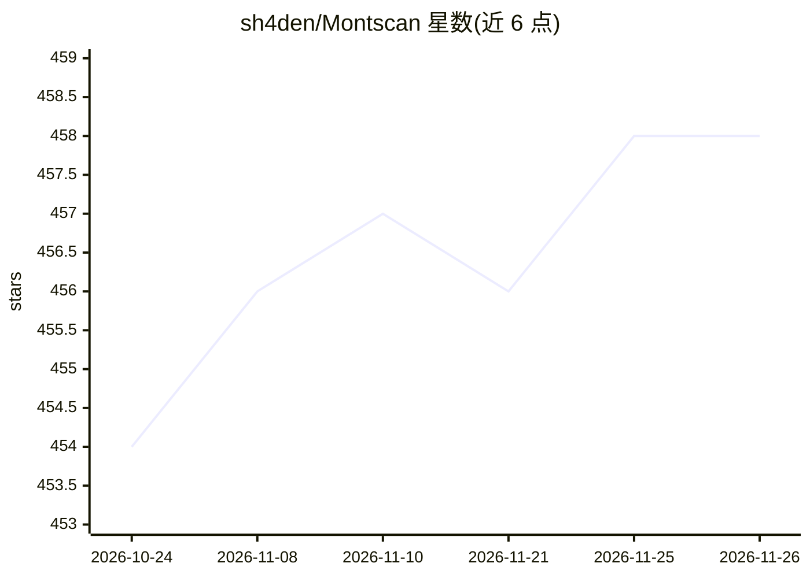

# sh4den/Montscan

⭐ 458 · Rust · MIT · 推送 2026-11-13 · [GitHub](https://github.com/sh4den/Montscan) · [官网](https://montscan.github.io) · 个人维护

**自托管扫描文档处理服务：本地视觉模型自动命名归档**

接收网络扫描仪发来的扫描件的 Rust 单二进制服务：通过 FTP、SFTP、SCP、轮询远程 SMB 共享或监听本地文件夹接收 PDF，用本地 Ollama 视觉模型读取内容并生成带日期的描述性文件名，再投递到 WebDAV（Nextcloud/ownCloud）、SMB 共享或本地文件夹。命名全程本地运行，文档不发给第三方 AI 服务，无需 API key。README 说明项目仍在开发中、未完全达到生产就绪，在 1000 份文档测试集上命名正确率 97.5%。

## 筛选速览

| 维度 | 判定 | 备注 |
|---|---|---|
| AI 角色 | `ai-native` | 本体是模型或模型工具 |
| 许可风险 | `permissive` | MIT |
| 部署形态 | `self-host` | docker 或自建部署 |
| 模型依赖 | local-ok | 支持本地模型 |
| 硬件要求 | `cpu-ok` | |
| 安装摩擦 | `low` | 无编译、无系统依赖或容器化 |
| 成熟度 | `idea` | |

## 能力要点

- 五种入站方式：FTP/SFTP/SCP 服务端、SMB 轮询、本地文件夹监听
- 本地 Ollama 视觉模型生成命名，无需 API key
- 投递到 WebDAV/SMB/本地文件夹，单二进制运行无外部程序依赖
- Docker Compose 部署，支持 CPU 或 NVIDIA GPU 配置

## 适用场景

- 让扫描仪直接把文件发到 Nextcloud 并自动命名
- 家庭/小团队自托管文档归档流程
- 不希望扫描文档经过第三方 AI 服务的环境

## 场景标签

`文档解析` · 领域:知识与检索

## 证据(README 行号)

> L26: **Montscan** receives scanned documents from your network scanner, reads them with a local Ollama vision model, giv
> L41: - Reads each document with an Ollama vision model and generates a dated, descriptive filename

## 星数曲线

2026-10-24 454 → 2026-11-26 458（+4）

---
*卡片 v1 · prompt 1.4 · 生成 2026-11-25 · 置信度 high · 依据 README sha `a1ec3a4762b4` · [字段定义](../../DATASET.md)*
