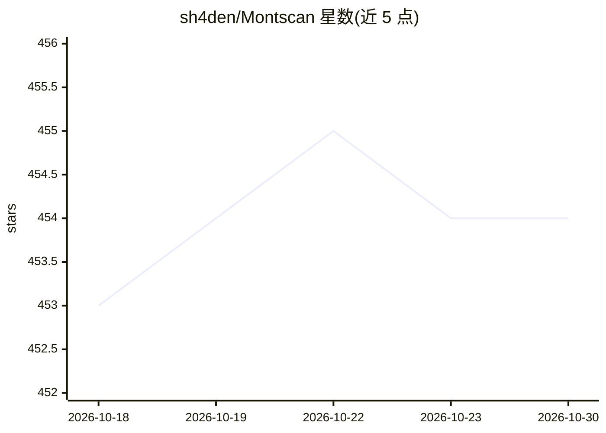

# sh4den/Montscan

⭐ 454 · Go · MIT · 推送 2026-08-24 · [GitHub](https://github.com/sh4den/Montscan) · [官网](https://montscan.github.io) · 个人维护

**扫描仪文档自动处理工具：AI 生成文件名并上传云端**

用 Go 编写的扫描文档处理器：通过内置 FTP 服务器、SMB 轮询或本地目录监听接收扫描 PDF，用 Poppler/ImageMagick 转图片后交由 Ollama 视觉模型（如 llava）分析内容并生成含描述与日期的文件名，再上传至 WebDAV（Nextcloud/ownCloud）或 SMB 共享。AI 命名失败时回退为时间戳文件名。README 自述尚在活跃开发、未完全达到生产就绪，1000 份文档小测试集上成功率 97.5%。提供本地构建与 Docker Compose 部署两种方式。

## 筛选速览

| 维度 | 判定 | 备注 |
|---|---|---|
| AI 角色 | `ai-enhanced` | 去掉 AI 部分产品仍成立 |
| 许可风险 | `permissive` | MIT |
| 部署形态 | `self-host` | docker 或自建部署 |
| 模型依赖 | local-ok | 支持本地模型 |
| 硬件要求 | — | 无带数字的原话,不猜 |
| 安装摩擦 | `low` | 无编译、无系统依赖或容器化 |
| 成熟度 | `idea` | |

## 能力要点

- 三种接入方式：FTP 服务器、SMB 轮询、本地目录监听
- Ollama 视觉模型生成描述性、含日期的文件名，失败时回退时间戳命名
- 上传目标支持 WebDAV（Nextcloud/ownCloud）与 SMB/CIFS 共享
- Docker Compose 部署，可选 NVIDIA GPU 加速 Ollama

## 适用场景

- 让网络扫描仪的文件自动获得有意义的文件名并归档到 Nextcloud
- 扫描件自动按内容命名后分发到公司 SMB 共享
- 监听本地文件夹批量重命名历史扫描 PDF

## 场景标签

`文档解析` · 领域:知识与检索

## 证据(README 行号)

> L16: - 👁️ **Vision AI Processing** - Analyzes scanned documents using Ollama vision models
> L230: - Montscan falls back to a timestamp filename (`scan_YYYYMMDD_HHMMSS.pdf`) on AI failure

## 星数曲线

2026-10-18 453 → 2026-10-30 454（+1）

---
*卡片 v1 · prompt 1.4 · 生成 2026-10-21 · 置信度 high · 依据 README sha `a3f93e51d050` · [字段定义](../../DATASET.md)*
