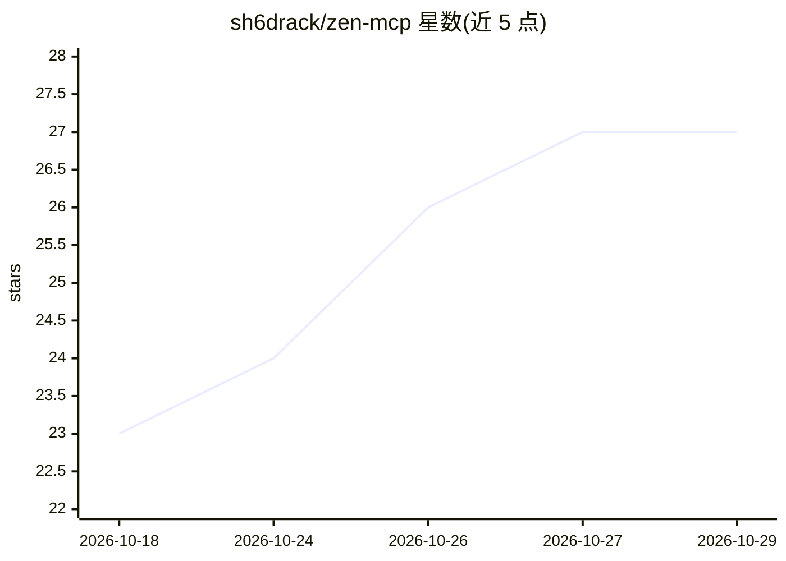

# sh6drack/zen-mcp

⭐ 27 · JavaScript · 推送 2026-05-16 · [GitHub](https://github.com/sh6drack/zen-mcp) · 个人维护

**面向 Zen Browser 的 MCP 服务器：让 AI 客户端自动化浏览器**

通过 WebDriver BiDi 协议经 WebSocket 直接连接 Zen Browser 的 MCP 服务器，不依赖 Selenium、Playwright 或浏览器驱动。提供 20 个工具，覆盖标签页管理、导航、页面截图与文本读取、表单填写、点击、键盘输入与页面内 JavaScript 执行，供 Claude Code、Cursor 等 MCP 客户端调用。表单填写使用原生 value setter 并派发 input/change 事件以兼容 React/Vue/Angular。要求 Zen Browser 与 Node.js 20+，已知不支持文件上传与拖拽（BiDi 规范限制）。

## 筛选速览

| 维度 | 判定 | 备注 |
|---|---|---|
| AI 角色 | `ai-ecosystem` | LLM/agent 周边工具 |
| 许可风险 | `none` | — |
| 部署形态 | `library` | 以包/库形式分发 |
| 模型依赖 | locked-api |  |
| 硬件要求 | — | 无带数字的原话,不猜 |
| 安装摩擦 | `low` | 无编译、无系统依赖或容器化 |
| 成熟度 | — | 结构信号不足 |

## 能力要点

- 20 个工具覆盖标签页、导航、截图、表单与键盘操作
- 直接经 WebSocket 使用 WebDriver BiDi，无需 Selenium/Playwright
- 表单填写用原生 value setter 派发事件，兼容 React/Vue/Angular
- 自动重连、僵尸会话恢复与 SIGINT/SIGTERM 清理

## 适用场景

- 让 Claude Code 或 Cursor 控制 Zen Browser 完成网页操作
- AI agent 自动填写表单与抓取页面内容
- 在页面上下文中执行 JavaScript 做自动化验证

## 场景标签

`浏览器自动化` · 领域:效率与自动化

## 证据(README 行号)

> L3: The first MCP server for **Zen Browser**. Automate Zen from Claude Code, Cursor, or any MCP client.
> L95: Claude Code  ──stdio/MCP──>  zen-mcp  ──WebSocket/BiDi──>  Zen Browser

## 星数曲线

2026-10-18 23 → 2026-10-29 27（+4）

---
*卡片 v1 · prompt 1.4 · 生成 2026-10-26 · 置信度 high · 依据 README sha `366848a16c46` · [字段定义](../../DATASET.md)*
