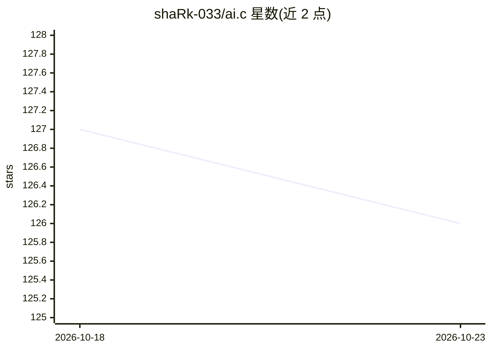

# shaRk-033/ai.c

⭐ 126 · C · MIT · 推送 2026-03-11 · [GitHub](https://github.com/shaRk-033/ai.c) · 个人维护

**纯 C 实现的 GPT-2 训练与生成程序**

用单文件 C 代码从零实现 GPT-2 的训练与 token 生成，包含 Attention、LayerNorm 等层的反向传播推导。数据预处理用 Python（依赖 tiktoken 分词），C 部分通过 gcc 编译：macOS 使用 Apple Accelerate 做 BLAS 矩阵乘法，Linux 使用 OpenMP 并行。参数与激活约 20GB，采用文件映射作为虚拟内存。作者自述为个人学习项目，作者称其为第二份 C 作品，并注明实现非最优、Attention 反传耗时待改进。

## 筛选速览

| 维度 | 判定 | 备注 |
|---|---|---|
| AI 角色 | `ai-native` | 本体是模型或模型工具 |
| 许可风险 | `permissive` | MIT |
| 部署形态 | `library` | 以包/库形式分发 |
| 模型依赖 | — | README 未给出锁定关系 |
| 硬件要求 | — | 无带数字的原话,不猜 |
| 安装摩擦 | `medium` | 含编译或系统依赖之一 |
| 成熟度 | `idea` | |

## 能力要点

- 纯 C 从零实现 GPT-2 训练与生成，含 Attention/LayerNorm 反向传播
- macOS 走 Apple Accelerate BLAS，Linux 走 OpenMP 并行
- 训练数据用 tiktoken 分词，Python 脚本预处理与解码 token

## 适用场景

- 学习 GPT-2 从零实现的内部机制
- 阅读 C 语言下张量与反向传播的实现方式
- 在 CPU 上小规模训练/运行 GPT-2 作为教学参考

## 场景标签

`模型训练` `教程课程` · 领域:学习与行业

## 证据(README 行号)

> L1: #### gpt2 written in plain C
> L32: ./train

## 星数曲线

2026-10-18 127 → 2026-10-23 126（-1）

---
*卡片 v1 · prompt 1.4 · 生成 2026-10-23 · 置信度 mid · 依据 README sha `9d4f76f2b144` · [字段定义](../../DATASET.md)*
