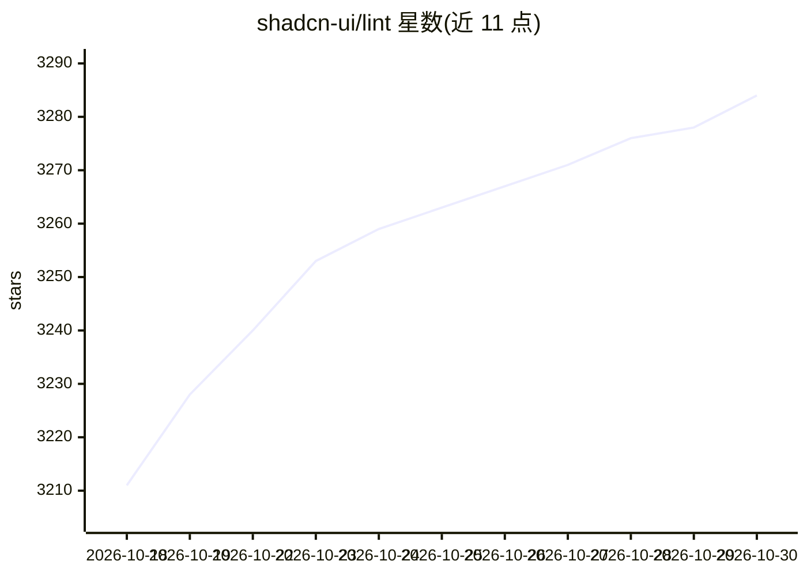

# shadcn-ui/lint

⭐ 3,284 · TypeScript · MIT · 推送 2026-10-19 · [GitHub](https://github.com/shadcn-ui/lint) · 组织维护

**面向 agent 的 Tailwind 设计系统 linter，错误信息供 agent 修复**

ESLint/Oxlint 插件形式的 linter，用于在 Tailwind v4 项目中执行设计系统规则：通过 no-restyle、no-raw-colors、no-arbitrary-values 等 6 条规则捕获违规样式，并支持自定义错误消息、占位符（{{sizes}}/{{component}}/{{file}}）与按组件的 contracts。错误信息面向编码 agent 设计，说明违规原因并给出基于项目组件、变体与主题的修复建议。支持 React、Vue、Svelte，不要求使用 shadcn/ui。需 Node.js 20.19+ 与 ESLint 9.30+/Oxlint 1.80+。README 报告在 150+ 次任务运行中测试，多数模型一轮修正后违规归零。

## 筛选速览

| 维度 | 判定 | 备注 |
|---|---|---|
| AI 角色 | `ai-ecosystem` | LLM/agent 周边工具 |
| 许可风险 | `permissive` | MIT |
| 部署形态 | `library` | 以包/库形式分发 |
| 模型依赖 | — | README 未给出锁定关系 |
| 硬件要求 | — | 无带数字的原话,不猜 |
| 安装摩擦 | `low` | 无编译、无系统依赖或容器化 |
| 成熟度 | — | 结构信号不足 |

## 能力要点

- 6 条规则覆盖 restyle、raw colors、arbitrary values、inline styles 等
- 错误消息可含组件可用 sizes/variants/主题文件路径等占位符
- 按组件名配置 contracts，同一组件不同部分可有不同规则
- 同一套规则与选项运行于 React、Vue、Svelte

## 适用场景

- 让编码 agent 在 UI 修改后自动运行 lint 并按提示修正
- 团队在设计系统上声明哪些样式允许改、哪些不允许
- 对第三方包组件应用规则而无需 fork 或封装

## 场景标签

 · 领域:前端工具/设计系统

## 证据(README 行号)

> L7: `@shadcn/lint` is an agent-first linter for Tailwind design systems.
> L131: We built `@shadcn/lint` for agents that write UI. The errors tell them

## 星数曲线

2026-10-18 3,211 → 2026-10-30 3,284（+73）

---
*卡片 v1 · prompt 1.4 · 生成 2026-10-20 · 置信度 high · 依据 README sha `164018307a28` · [字段定义](../../DATASET.md)*
