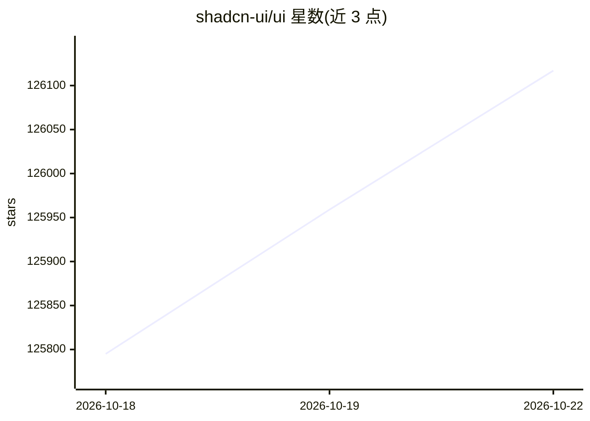

# shadcn-ui/ui

⭐ 126,117 · TypeScript · MIT · 推送 2026-10-20 · [GitHub](https://github.com/shadcn-ui/ui) · [官网](https://ui.shadcn.com) · 组织维护

**给开发者的可定制 React 组件集合，用于构建自己的组件库**

shadcn/ui 提供一组可组合、注重可访问性的 React 组件，代码复制到用户项目中，可自行定制与扩展，用于构建自己的组件库。README 说明文档位于 ui.shadcn.com/docs，采用 MIT 许可证，接受社区贡献。README 本身仅作入口，安装方式与框架集成细节（如 Next.js、Radix UI 等主题标签所示）需查阅其文档站点。

## 筛选速览

| 维度 | 判定 | 备注 |
|---|---|---|
| AI 角色 | `ai-ecosystem` | LLM/agent 周边工具 |
| 许可风险 | `permissive` | MIT |
| 部署形态 | `None` |  |
| 模型依赖 | — | README 未给出锁定关系 |
| 硬件要求 | — | 无带数字的原话,不猜 |
| 安装摩擦 | `low` | 无编译、无系统依赖或容器化 |
| 成熟度 | — | 结构信号不足 |

## 动量与使用信号

- 维护:`active` — 距上次 push 1.1 天,年发版 75,469 位贡献者
- 涨星:近 1 天 **+65**(自 20261016 起算)

## 能力要点

- 可组合、注重可访问性的组件集
- 代码归用户所有，可定制、扩展并构建自有组件库
- MIT 许可证开源

## 适用场景

- 为 React 应用搭建一套可完全控制的组件库
- 在定制 UI 组件时参考其组件实现

## 场景标签

 · 领域:前端开发/UI 组件

## 证据(README 行号)

> L3: A set of beautifully designed components that you can customize, extend, and build on. Start here then make it your 
> L14: Licensed under the MIT license.

## 星数曲线

2026-10-18 125,795 → 2026-10-22 126,117（+322）

---
*卡片 v1 · prompt 1.4 · 生成 2026-10-18 · 置信度 high · 依据 README sha `8da378c28cb1` · [字段定义](../../DATASET.md)*
