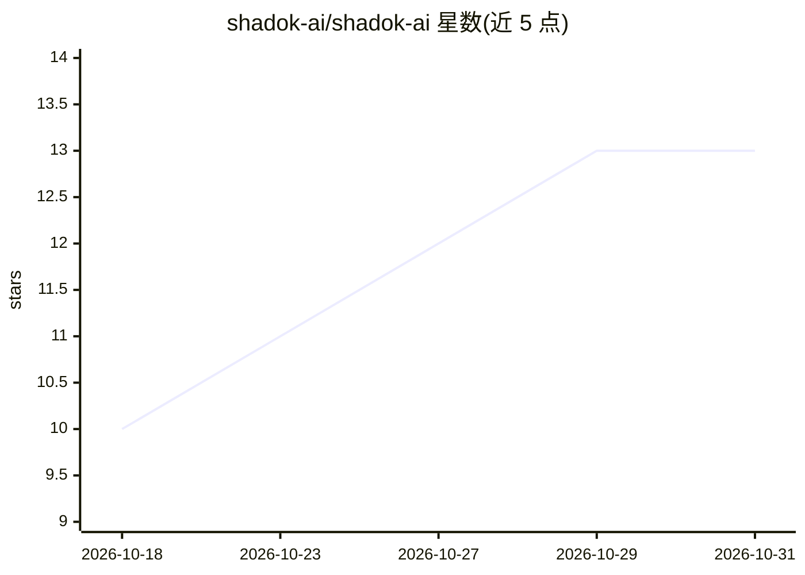

# shadok-ai/shadok-ai

⭐ 13 · TypeScript · AGPL-3.0 · 推送 2026-10-30 · [GitHub](https://github.com/shadok-ai/shadok-ai) · [官网](https://shadok.ai) · 组织维护

**并行运行与管控多个 Claude Code agent 的驾驶舱工具**

基于 Node.js 的 Claude Code agent 编排工具：在独立 git worktree 中并行运行多个 `claude` 会话，复用用户已有的 Claude 订阅；通过浏览器或 Telegram 回答 agent 提问。提供 agent 派生与回报、角色 profile 与权限护栏、仓库外的密钥库、5h/7d 配额仪表与限速、定时任务（可用不唤醒模型的守卫命令实现零 token 静默运行）、本地 whisper.cpp 语音转录等。运行需 Node ≥ 20 与 `claude` CLI，tmux 由其自动安装。

## 筛选速览

| 维度 | 判定 | 备注 |
|---|---|---|
| AI 角色 | `ai-ecosystem` | LLM/agent 周边工具 |
| 许可风险 | `viral` | AGPL-3.0 |
| 部署形态 | `self-host` | docker 或自建部署 |
| 模型依赖 | locked-api |  |
| 硬件要求 | — | 无带数字的原话,不猜 |
| 安装摩擦 | `low` | 无编译、无系统依赖或容器化 |
| 成熟度 | — | 结构信号不足 |

## 能力要点

- 多个 Claude Code 会话在独立 git worktree 中并行运行，agent 可派生并接收子 agent 完成事件
- profile 定义角色、权限护栏、模型与注入密钥；密钥存于仓库外的 vault
- 定时提示词可携带守卫命令，静默时不唤醒模型、零 token 消耗
- Telegram 集成：问答、按 topic 分 agent、语音本地转录（whisper.cpp）后执行

## 适用场景

- 并行派发多个 AI agent 处理不同分支的开发任务
- 不在电脑前时通过 Telegram 回答 agent 提问或发语音指令
- 以定时任务+守卫命令做低成本监控与报告

## 场景标签

`编码 Agent` · 领域:编码与开发

## 证据(README 行号)

> L5:  Run real Claude Code sessions side by side, each in its own git worktree,
> L46: `claude` CLI on **your** Claude subscription —

## 星数曲线

2026-10-18 10 → 2026-10-31 13（+3）

---
*卡片 v1 · prompt 1.4 · 生成 2026-10-31 · 置信度 mid · 依据 README sha `66dabad543f1` · [字段定义](../../DATASET.md)*
