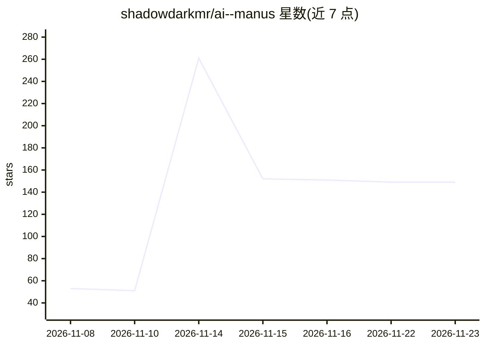

# shadowdarkmr/ai--manus

⭐ 149 · Apache-2.0 · 推送 2026-11-17 · [GitHub](https://github.com/shadowdarkmr/ai--manus) · 个人维护

**面向个人日常任务的自主 AI Agent，可执行代码并控制浏览器**

Manus 是一个自主 AI agent 系统，描述为可代用户编写并执行脚本、控制浏览器（导航网页、填写表单、收集信息）并完成多步骤任务，定位为家庭、学习与轻量办公场景的个人助手，而非企业平台或重型工作室套件。README 说明了硬件兼容表（最低双核 CPU、4 GB 内存）与上手步骤（配置、测试、调整触发条件），但未提供任何安装命令、技术架构或模型接入细节。

## 筛选速览

| 维度 | 判定 | 备注 |
|---|---|---|
| AI 角色 | `ai-native` | 本体是模型或模型工具 |
| 许可风险 | `permissive` | Apache-2.0 |
| 部署形态 | `None` |  |
| 模型依赖 | — | README 未给出锁定关系 |
| 硬件要求 | — | 无带数字的原话,不猜 |
| 安装摩擦 | `low` | 无编译、无系统依赖或容器化 |
| 成熟度 | — | 结构信号不足 |

## 能力要点

- 自主执行代码与脚本
- 浏览器控制：导航网页、填表、收集信息
- 多步骤任务，代码与浏览器操作可在同一流程中衔接
- 面向家庭/学习/轻量办公的小规模场景

## 适用场景

- 让 agent 代为收集网页资料并整理研究笔记
- 自动执行重复性小任务如填表、文件整理
- 无需编程背景即可运行脚本完成日常小项目

## 场景标签

`AI 助手` `浏览器自动化` · 领域:效率与自动化

## 证据(README 行号)

> L18: Manus is an autonomous AI agent designed to run code and control a browser on your behalf. Instead of acting like a
> L22: Manus is not a heavy studio suite or a complex enterprise platform. It is a focused helper built for home, study, a

## 星数曲线

2026-11-08 53 → 2026-11-23 149（+96）

---
*卡片 v1 · prompt 1.4 · 生成 2026-11-17 · 置信度 mid · 依据 README sha `0039b4bc6549` · [字段定义](../../DATASET.md)*
