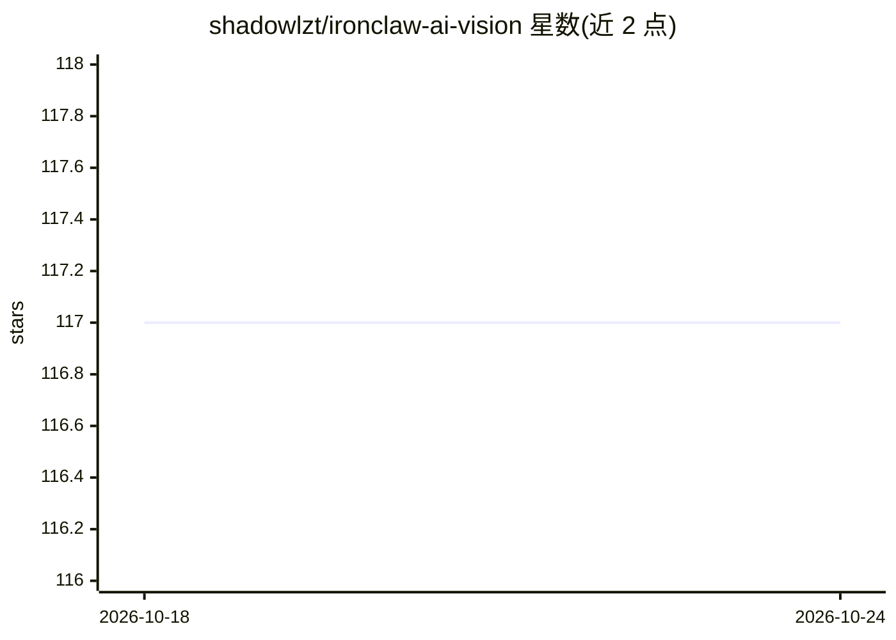

# shadowlzt/ironclaw-ai-vision

⭐ 117 · HTML · 推送 2026-10-24 · [GitHub](https://github.com/shadowlzt/ironclaw-ai-vision) · 个人维护

**离线优先的认知训练 PWA：导入内容并用 AI 生成对抗式思维训练**

面向个人用户的思维训练应用（PWA + Android 封装）：从 YouTube、网页、PDF、图片等多源导入内容，AI agent 抽取认知原则并压缩为 Reflex Byte，随后生成对抗式微场景进行训练，配合基于 SM-2 的间隔重复调度巩固。本地多 agent 协作与 ONNX runtime 本地推理，声明无云端 API 调用，训练数据仅存本地，在线时可选跨设备同步。README 提供功能描述与下载链接，未给出具体安装/运行命令。

## 筛选速览

| 维度 | 判定 | 备注 |
|---|---|---|
| AI 角色 | `ai-native` | 本体是模型或模型工具 |
| 许可风险 | `none` | — |
| 部署形态 | `None` |  |
| 模型依赖 | — | README 未给出锁定关系 |
| 硬件要求 | — | 无带数字的原话,不猜 |
| 安装摩擦 | `low` | 无编译、无系统依赖或容器化 |
| 成熟度 | — | 结构信号不足 |

## 能力要点

- 多源内容导入并抽取认知原则为 Reflex Byte（视频/音频/文本/图像）
- 本地 agent 群 + ONNX runtime 生成对抗式训练场景，无云端 API 调用
- SM-2 变体间隔重复调度并加权情绪状态
- PWA 离线运行，训练数据本地存储，可选跨设备同步

## 适用场景

- 把讲座、文章中的思维模型导入并反复演练成条件反射
- 通过对抗式微场景在压力模拟下练习决策
- 用 5 分钟微习惯会话进行日常认知训练

## 场景标签

 · 领域:个人成长/认知训练应用

## 证据(README 行号)

> L13: Inspired by the offline-first, multi-source import architecture of IronClaw, ReflexForge reimagines how humans buil
> L45: ### 🤖 Full Agentic Tool-Calling (Offline)
> L88: - **Scenario Generator:** Uses a local inference engine (ONNX runtime) to generate adversarial scenarios. No cloud 

## 星数曲线

2026-10-18 117 → 2026-10-24 117（+0）

---
*卡片 v1 · prompt 1.4 · 生成 2026-10-23 · 置信度 high · 依据 README sha `ec91a29bfd35` · [字段定义](../../DATASET.md)*
