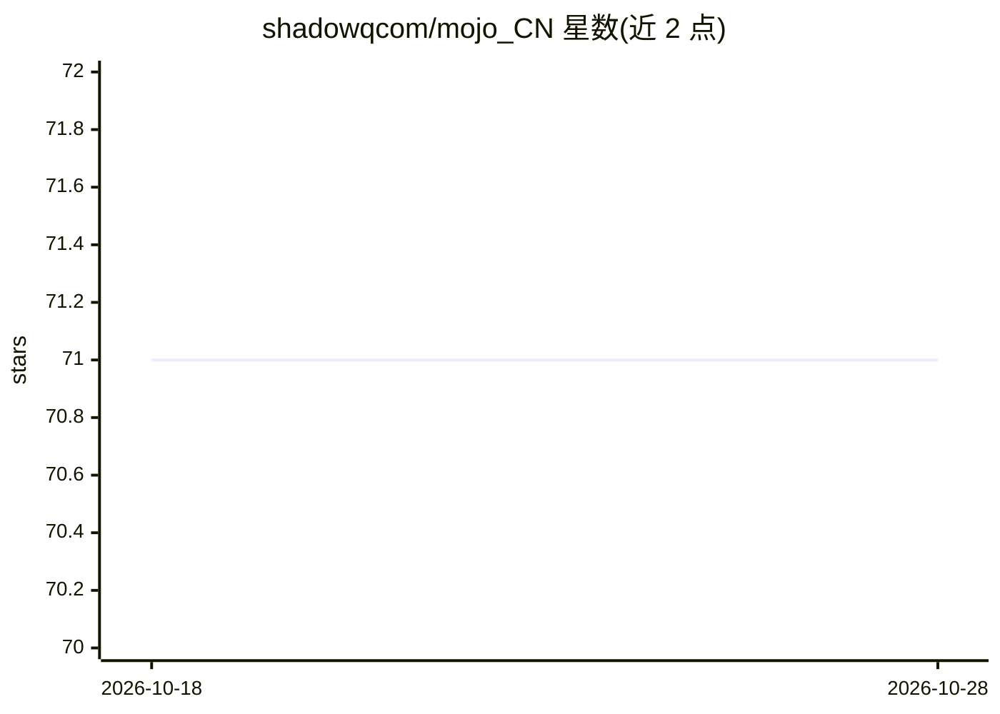

# shadowqcom/mojo_CN

⭐ 71 · 推送 2026-08-19 · [GitHub](https://github.com/shadowqcom/mojo_CN) · [官网](https://mojocn.org) · 组织维护 · 中文 README

**Mojo 编程语言中文学习资料与开发者社区入口**

由 Mojo中文网 发起的社区项目，定位为 Mojo 语言的学习与交流枢纽：汇集 Mojo中文网、Mojo 文档翻译、开发者社区链接，并维护微信群、Telegram 与 QQ 群（777214484、925241368）等中文开发者交流渠道。README 未包含教程正文或安装说明，主体为导航性质；项目采用 CC BY-NC-ND 4.0 许可。

## 筛选速览

| 维度 | 判定 | 备注 |
|---|---|---|
| AI 角色 | `ai-knowledge` | 知识聚合/清单类 |
| 许可风险 | `none` | — |
| 部署形态 | `None` |  |
| 模型依赖 | — | README 未给出锁定关系 |
| 硬件要求 | — | 无带数字的原话,不猜 |
| 安装摩擦 | `low` | 无编译、无系统依赖或容器化 |
| 成熟度 | — | 结构信号不足 |

## 能力要点

- 汇集 Mojo中文网、Mojo 文档与开发者社区入口
- 提供微信/Telegram/QQ 中文开发者交流群
- 开展 Mojo 文档的中文翻译工作

## 适用场景

- 查找 Mojo 语言的中文资料与文档
- 加入中文 Mojo 开发者交流群
- 参与 Mojo 文档翻译与社区贡献

## 场景标签

`精选清单` · 领域:学习与行业

## 证据(README 行号)

> L4: 本项目由Mojo中文网发起，旨在学习Mojo语言和翻译Mojo文档，致力于让更多开发者参与交流。
> L3: Mojo 是一种新的编程语言，我们是 Mojo 开发者。

## 星数曲线

2026-10-18 71 → 2026-10-28 71（+0）

---
*卡片 v1 · prompt 1.4 · 生成 2026-10-24 · 置信度 high · 依据 README sha `9862f29d447c` · [字段定义](../../DATASET.md)*
