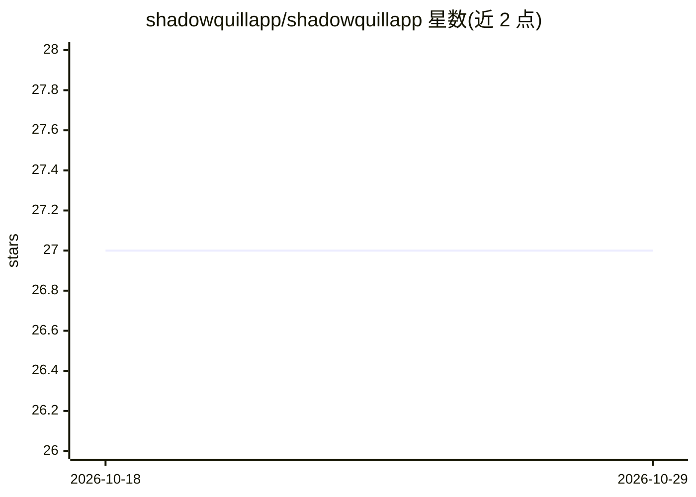

# shadowquillapp/shadowquillapp

⭐ 27 · TypeScript · MIT · 推送 2026-08-13 · [GitHub](https://github.com/shadowquillapp/shadowquillapp) · 组织维护

**本地离线提示词工程应用：通过 Ollama 运行 Gemma 生成结构化提示词**

Electron + Next.js 桌面应用，面向需要编写提示词的用户：将粗略想法转化为结构化提示词，通过本地 Ollama 实例调用 Google Gemma 系列模型，设置完成后无需联网、无账号、无遥测，项目/预设/配置存储在本地磁盘。提供 8 标签页、7 种任务类型、10 个默认预设、Preset Studio 预设构建（带实时预览）与版本历史导航。开发运行依赖 pnpm，要求预先安装 Ollama 并拉取至少一个 Gemma 模型。

## 筛选速览

| 维度 | 判定 | 备注 |
|---|---|---|
| AI 角色 | `ai-native` | 本体是模型或模型工具 |
| 许可风险 | `permissive` | MIT |
| 部署形态 | `library` | 以包/库形式分发 |
| 模型依赖 | local-ok | 支持本地模型 |
| 硬件要求 | — | 无带数字的原话,不猜 |
| 安装摩擦 | `low` | 无编译、无系统依赖或容器化 |
| 成熟度 | — | 结构信号不足 |

## 能力要点

- 通过本地 Ollama 运行 Gemma 模型，自动发现兼容模型
- 7 种任务类型与 10 个默认预设，Preset Studio 支持自定义预设（实时预览）
- 8 标签页并行管理提示词，带版本历史前后导航
- 离线优先、无遥测、本地存储项目与配置

## 适用场景

- 在不上传云端的前提下生成和打磨提示词
- 按意图/分析/叙事等任务类型批量构建提示词工作流
- 维护多个提示词项目并对比历史版本

## 场景标签

`提示工程` · 领域:Agent 开发

## 证据(README 行号)

> L10: ShadowQuill turns rough ideas into structured prompts you can actually use. It talks to Ollama and runs Google Gemm
> L62: - **Offline-first** — Works without internet once Ollama and the app are set up

## 星数曲线

2026-10-18 27 → 2026-10-29 27（+0）

---
*卡片 v1 · prompt 1.4 · 生成 2026-10-26 · 置信度 mid · 依据 README sha `4d03cd5c41bb` · [字段定义](../../DATASET.md)*
