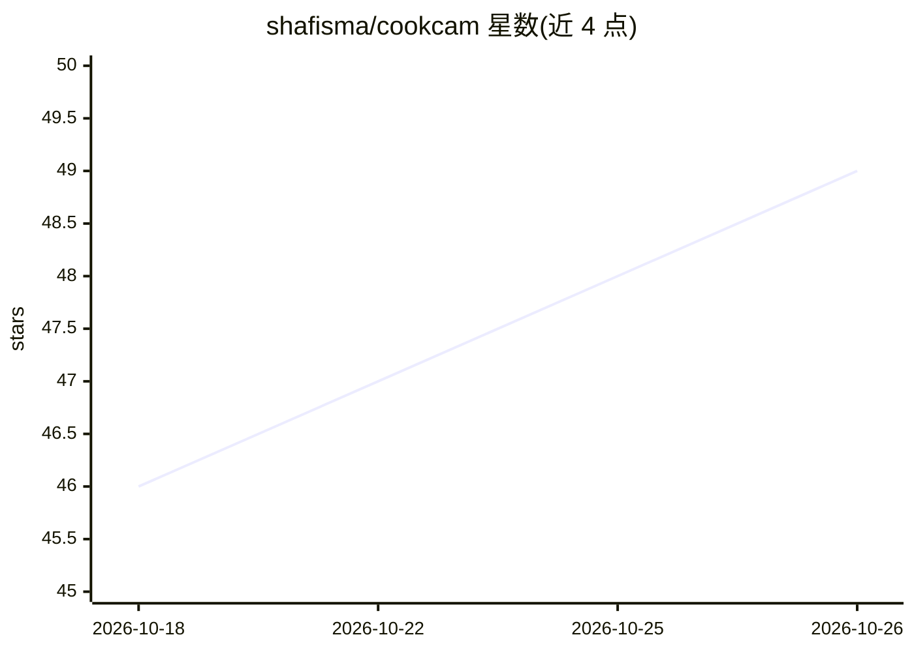

# shafisma/cookcam

⭐ 49 · JavaScript · 推送 2026-03-09 · [GitHub](https://github.com/shafisma/cookcam) · 个人维护

**实时 AI 烹饪助手：摄像头看厨房，语音逐步指导做菜**

面向终端用户的网页版实时烹饪助手：浏览器采集摄像头（768×768 JPEG，1 FPS）与麦克风（16kHz PCM）流，经 WebSocket 传至 FastAPI 后端，代理到 Gemini Live API（Gemini 2.5 Flash Native Audio）实现多模态实时对话。功能包括食材识别、菜谱建议、语音逐步指导、食材替换建议、6 个函数调用工具（计时器/菜谱/清单等）与营养估算。需要 Google AI API key，可本地 pip 运行或经 Docker 部署到 Cloud Run，Firestore 存储可选（可退化为内存存储）。

## 筛选速览

| 维度 | 判定 | 备注 |
|---|---|---|
| AI 角色 | `ai-native` | 本体是模型或模型工具 |
| 许可风险 | `none` | — |
| 部署形态 | `library` | 以包/库形式分发 |
| 模型依赖 | — | README 未给出锁定关系 |
| 硬件要求 | — | 无带数字的原话,不猜 |
| 安装摩擦 | `low` | 无编译、无系统依赖或容器化 |
| 成熟度 | — | 结构信号不足 |

## 能力要点

- 摄像头+麦克风实时流式接入 Gemini Live API，支持语音打断
- 实时食材识别与基于可见食材的菜谱建议
- 6 个函数调用工具：语音计时器、菜谱保存、食材清单等
- 支持 Cloud Run 一键部署与 Firestore/内存双存储

## 适用场景

- 做饭时让 AI 通过摄像头实时指导每一步操作
- 识别冰箱现有食材并获取菜谱建议
- 厨房嘈杂环境改用文字聊天提问

## 场景标签

`语音 Agent` `多模态` · 领域:对话与助手

## 证据(README 行号)

> L3: **Real-time AI cooking assistant** that sees your kitchen through your webcam and guides you step-by-step through na
> L141: |**AI Model**|Gemini 2.5 Flash Native Audio (Live API)|
> L162: 4. **Gemini** processes vision + audio, returns voice responses at 24kHz

## 星数曲线

2026-10-18 46 → 2026-10-26 49（+3）

---
*卡片 v1 · prompt 1.4 · 生成 2026-10-25 · 置信度 mid · 依据 README sha `7d20b060a1c3` · [字段定义](../../DATASET.md)*
