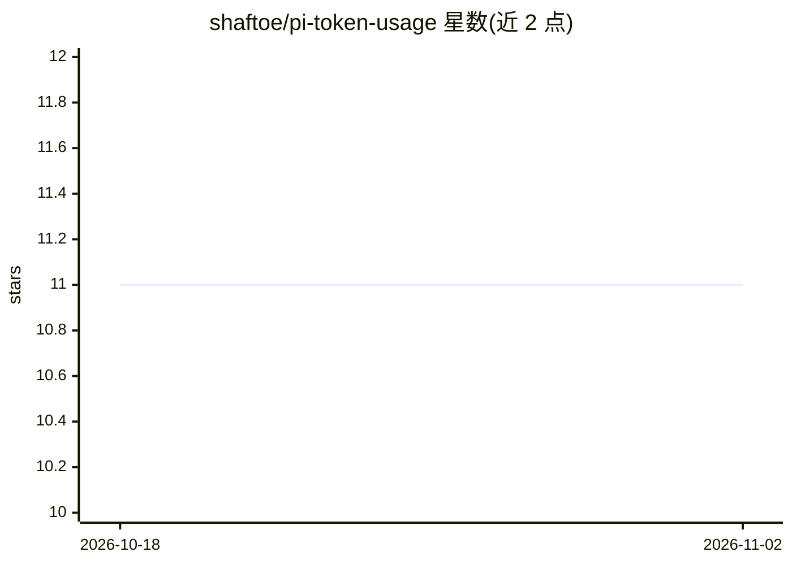

# shaftoe/pi-token-usage

⭐ 11 · TypeScript · MIT · 推送 2026-10-31 · [GitHub](https://github.com/shaftoe/pi-token-usage) · [官网](https://www.npmjs.com/package/@alexanderfortin/pi-token-usage/) · 个人维护

**Pi coding agent 扩展：分析会话文件的 token 用量与成本**

Pi coding agent 的扩展，提供两个命令：/token-report 扫描 ~/.pi/agent/sessions 下的 .jsonl 会话文件，解析 assistant 消息的 usage 数据，按模型+提供商聚合 token 数与成本，支持 table（TUI）、CSV、JSON、Markdown 输出，可写入文件；/token-prune 按天数与空文件规则删除旧会话文件，带 dry-run 与 --force 安全机制。面向使用 Pi coding agent 并需追踪 token 消耗与清理会话数据的开发者，经 NPM 安装。

## 筛选速览

| 维度 | 判定 | 备注 |
|---|---|---|
| AI 角色 | `ai-ecosystem` | LLM/agent 周边工具 |
| 许可风险 | `permissive` | MIT |
| 部署形态 | `library` | 以包/库形式分发 |
| 模型依赖 | — | README 未给出锁定关系 |
| 硬件要求 | — | 无带数字的原话,不猜 |
| 安装摩擦 | `low` | 无编译、无系统依赖或容器化 |
| 成熟度 | — | 结构信号不足 |

## 能力要点

- 按模型+提供商聚合会话文件的 token 数与成本
- table/CSV/JSON/Markdown 四种输出格式，可保存到文件
- 会话文件清理含 dry-run 预览与批量删除确认机制
- 读取本地 .jsonl 文件，无需外部 API 调用

## 适用场景

- 查看各模型在历史会话中的 token 消耗与花费
- 定期清理过期的 coding agent 会话文件
- 把 token 用量报告导出为 CSV/Markdown 用于记录

## 场景标签

 · 领域:开发工具/AI 可观测

## 证据(README 行号)

> L3: A Pi coding agent extension that
> L5: - analyzes token usage and cost across your session files
> L97: 2. Parses each file, extracting `assistant` messages with `usage` data

## 星数曲线

2026-10-18 11 → 2026-11-02 11（+0）

---
*卡片 v1 · prompt 1.4 · 生成 2026-11-01 · 置信度 high · 依据 README sha `ead12f61a43f` · [字段定义](../../DATASET.md)*
