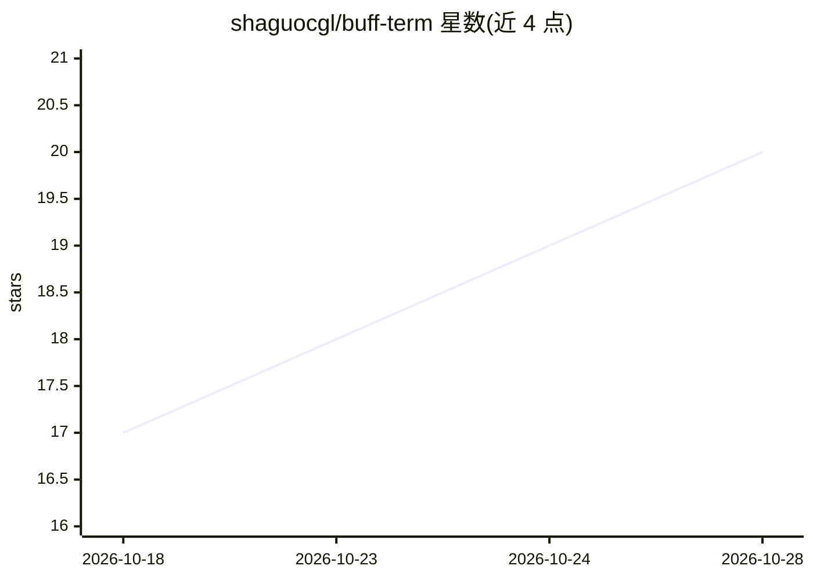

# shaguocgl/buff-term

⭐ 20 · Rust · MIT · 推送 2026-10-27 · [GitHub](https://github.com/shaguocgl/buff-term) · [官网](https://buffterm.com) · 个人维护 · 中文 README

**带 AI Agent 与 MCP 服务器能力的桌面 SSH 运维工具**

基于 Tauri 2（Rust 后端）+ React 19 的桌面 SSH/SFTP 客户端，终端、SFTP、AI、MCP、监控全部走 russh 协议级实现。内置自研 AI Agent 编排层（SSE 流式解析、工具调用循环、审批与审计），通过 OpenAI 兼容协议接入 DeepSeek/Qwen/Kimi/Ollama 等模型，用自然语言执行命令、排查问题与巡检整改；可将多台主机作为 MCP 服务器开放给 Claude Desktop、Codex 等外部 AI 工具。凭据 AES-256-GCM 加密存本机，提供三级安全级别、高危命令拦截与输出脱敏。macOS/Windows 提供安装包，macOS 版未做 Apple 公证。

## 筛选速览

| 维度 | 判定 | 备注 |
|---|---|---|
| AI 角色 | `ai-enhanced` | 去掉 AI 部分产品仍成立 |
| 许可风险 | `permissive` | MIT |
| 部署形态 | `desktop` | 安装包/桌面程序 |
| 模型依赖 | local-ok | 支持本地模型 |
| 硬件要求 | — | 无带数字的原话,不猜 |
| 安装摩擦 | `low` | 无编译、无系统依赖或容器化 |
| 成熟度 | — | 结构信号不足 |

## 能力要点

- 自研 Agent 编排层，SSE 流式解析 + 工具调用循环，不依赖 LangChain 等框架
- 作为 MCP 服务器（Streamable HTTP + JSON-RPC + token 认证）将主机能力开放给外部 AI 工具
- 三级安全级别、高危命令拦截、AI 操作审批与审计留痕
- AI 巡检生成 Markdown 报告并支持一键整改与邮件通知

## 适用场景

- 用自然语言让 AI 在远程主机上查询状态、排查问题、安装程序
- 把多台服务器暴露为 MCP 服务，供 Claude Desktop 等外部 AI 工具调用
- SSH 日常运维中拦截高危命令并保留操作审计

## 场景标签

 · 领域:开发运维工具/远程服务器管理

## 证据(README 行号)

> L18: buffTerm 是一款**面向 AI 的 SSH 工具与 MCP 服务器**，内置**自研 AI Agent 编排层**，接入任意 OpenAI 兼容协议的大模型（如 DeepSeek、Qwen、Kimi 等），用自然语言就能查
> L52: - **buffTerm 作为 MCP 服务器**：基于 Streamable HTTP + JSON-RPC + token 认证，把勾选的服务器能力开放给 Codex、Claude Desktop 等外部 AI 工具
> L58: - **协议级 SSH**：交互终端、AI、MCP、监控、巡检与 SFTP 全部基于 `russh` / `russh-sftp`，不调用系统 `ssh` / `sftp` 命令

## 星数曲线

2026-10-18 17 → 2026-10-28 20（+3）

---
*卡片 v1 · prompt 1.4 · 生成 2026-10-28 · 置信度 high · 依据 README sha `82a3d6a3df30` · [字段定义](../../DATASET.md)*
