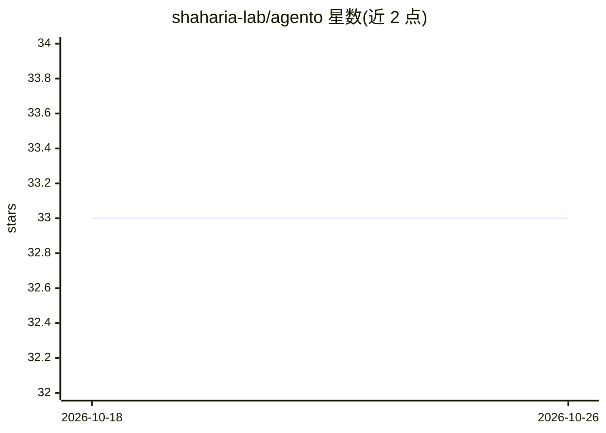

# shaharia-lab/agento

⭐ 33 · Rust · MIT · 推送 2026-10-23 · [GitHub](https://github.com/shaharia-lab/agento) · [官网](https://myagento.app/) · 个人维护

**Claude Code 用户的桌面平台：会话成本分析与个人 Agent 运行**

面向 Claude Code 用户的本地桌面应用（macOS/Windows/Linux）：读取 Claude Code 写入磁盘的会话文件，生成成本、token 构成、缓存命中与工具错误等分析，支持会话搜索与逐步回放；内置 Agent 构建与聊天、定时任务调度、GitHub/Slack/Jira 等集成（以应用内 MCP server 运行），并附带默认关闭的 OpenAI 兼容/Anthropic 原生 LLM Gateway（含按别名路由与 fallback）。数据存于本地 SQLite，无账号无遥测；运行需已安装并登录的 Claude Code CLI。

## 筛选速览

| 维度 | 判定 | 备注 |
|---|---|---|
| AI 角色 | `ai-ecosystem` | LLM/agent 周边工具 |
| 许可风险 | `permissive` | MIT |
| 部署形态 | `desktop` | 安装包/桌面程序 |
| 模型依赖 | locked-api |  |
| 硬件要求 | — | 无带数字的原话,不猜 |
| 安装摩擦 | `low` | 无编译、无系统依赖或容器化 |
| 成熟度 | — | 结构信号不足 |

## 能力要点

- 读取本地 Claude Code 会话文件生成成本/token/缓存/工具错误分析
- 5000 会话级别 SQL 过滤搜索与逐步回放
- 自建 Agent 聊天、定时调度与应用内 MCP 集成
- 内置 OpenAI 兼容与 Anthropic 原生的 LLM Gateway（默认关闭，支持有序 fallback）

## 适用场景

- 查看我在 Claude Code 上花了多少钱、哪些模型和项目在消耗 token
- 回放失控的自主运行会话定位问题步骤
- 构建并定时调度自己的 Agent，连接 GitHub/Slack/Jira 等工具
- 通过本地网关为多个工具统一转发并记录 LLM 花费

## 场景标签

`Agent 框架` `模型网关` `LLM 可观测性` · 领域:Agent 开发

## 证据(README 行号)

> L5: Agento reads the session files Claude Code already writes to your disk and turns them into
> L161: in the app — every turn runs through your own Claude Code CLI, tool calls and Markdown
> L193: Turn on the built-in **LLM Gateway** and Agento serves an OpenAI-compatible and an

## 星数曲线

2026-10-18 33 → 2026-10-26 33（+0）

---
*卡片 v1 · prompt 1.4 · 生成 2026-10-25 · 置信度 mid · 依据 README sha `ab8b4bc6e2c6` · [字段定义](../../DATASET.md)*
