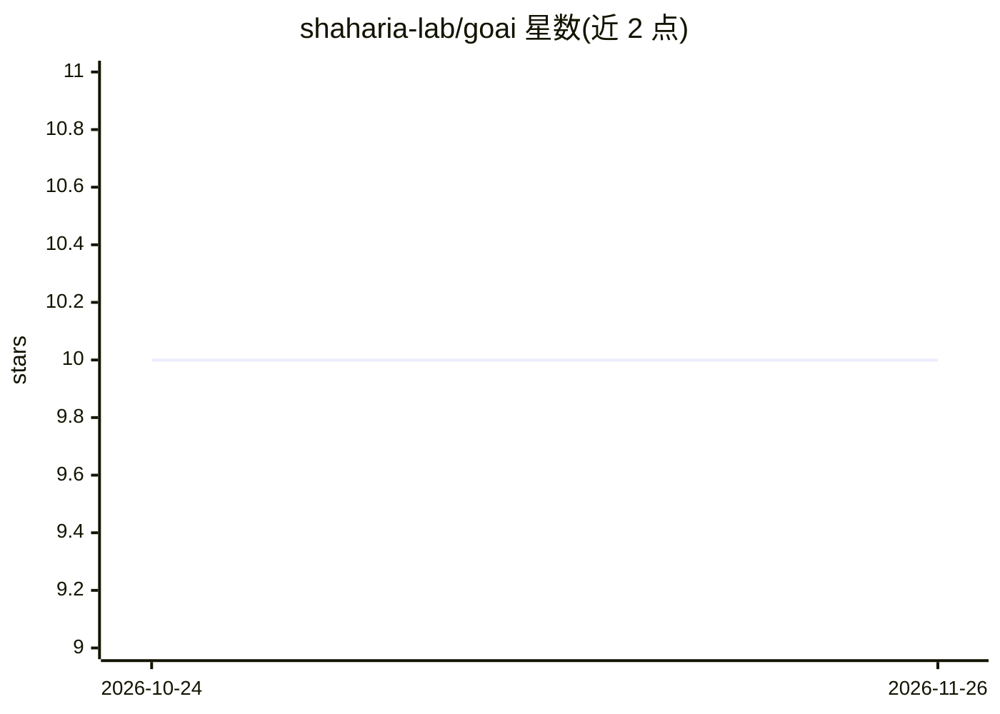

# shaharia-lab/goai

⭐ 10 · Go · MIT · 推送 2026-11-14 · [GitHub](https://github.com/shaharia-lab/goai) · 组织维护

**Go 开发者的 LLM 接入 SDK：统一接口对接多家模型与向量存储**

面向 Go 语言的 AI 库，将多家 LLM 提供商（OpenAI、Anthropic Claude、AWS Bedrock）、向量嵌入生成与 PostgreSQL 向量存储整合在统一接口下，支持流式输出与类型安全操作，并提供相似度搜索能力。文档覆盖 LLM 集成、嵌入生成、向量操作与 Go 语言 MCP Server 构建指南；附 _examples 目录，可通过 go run 直接运行示例。以 go get 方式安装，MIT 许可，由 Shaharia Lab 维护。

## 筛选速览

| 维度 | 判定 | 备注 |
|---|---|---|
| AI 角色 | `ai-ecosystem` | LLM/agent 周边工具 |
| 许可风险 | `permissive` | MIT |
| 部署形态 | `None` |  |
| 模型依赖 | locked-api |  |
| 硬件要求 | — | 无带数字的原话,不猜 |
| 安装摩擦 | `low` | 无编译、无系统依赖或容器化 |
| 成熟度 | — | 结构信号不足 |

## 能力要点

- 统一接口对接 OpenAI、Anthropic Claude、AWS Bedrock
- 嵌入生成与 PostgreSQL 向量存储及相似度搜索
- 支持流式输出与类型安全操作
- 文档包含 Go 语言 MCP Server 指南

## 适用场景

- 在 Go 应用中接入多家 LLM 提供商
- 用 PostgreSQL 存储向量并做相似度检索
- 用 Go 实现 MCP Server

## 场景标签

`模型网关` · 领域:Agent 开发

## 证据(README 行号)

> L16: GoAI is a powerful Go library that seamlessly integrates multiple LLM providers, vector embeddings,
> L17: and vector storage capabilities. Built for developers who want a clean, unified interface for AI operations.

## 星数曲线

2026-10-24 10 → 2026-11-26 10（+0）

---
*卡片 v1 · prompt 1.4 · 生成 2026-11-19 · 置信度 high · 依据 README sha `d83c9ffd79d3` · [字段定义](../../DATASET.md)*
