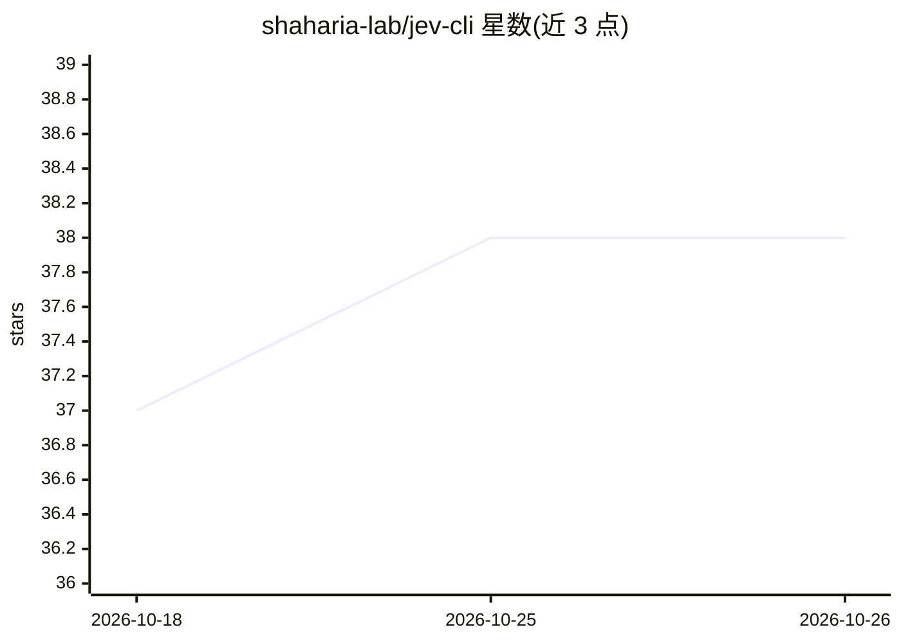

# shaharia-lab/jev-cli

⭐ 38 · Rust · Apache-2.0 · 推送 2026-10-20 · [GitHub](https://github.com/shaharia-lab/jev-cli) · 组织维护

**TypeSafe AI Jev 模型的命令行客户端：对文本提问返回校准概率**

Rust 编写的 CLI 工具，调用 TypeSafe AI 的 Jev 分类模型，向任意文本提出 yes/no、多选、量表三类问题，返回 0-1 校准概率而非生成文本。答案以稳定退出码供 shell/CI 分支使用，以 JSON 供脚本消费，并通过 `jev mcp serve` 以 MCP 工具形式供 AI agent 调用（含单次花费上限与默认拒绝文件访问）。支持 YAML 多问题请求、批处理（JSONL/CSV 流式、断点续跑）、离线免费校验与 dry-run 计价。评估需 TypeSafe API key，项目为非官方社区构建。

## 筛选速览

| 维度 | 判定 | 备注 |
|---|---|---|
| AI 角色 | `ai-ecosystem` | LLM/agent 周边工具 |
| 许可风险 | `permissive` | Apache-2.0 |
| 部署形态 | `library` | 以包/库形式分发 |
| 模型依赖 | — | README 未给出锁定关系 |
| 硬件要求 | — | 无带数字的原话,不猜 |
| 安装摩擦 | `low` | 无编译、无系统依赖或容器化 |
| 成熟度 | `idea` | |

## 能力要点

- 三类题型（noul/choice/score）返回校准概率与置信度
- 稳定退出码契约与 abstain band（0.5 附近不确定性转人工）
- `jev mcp serve` 提供 MCP 工具，含单次花费上限与默认拒绝文件访问
- `jev batch run` 流式批处理、限速退避与 --resume 断点续跑

## 适用场景

- 在 CI 或 shell 脚本中按文本判断结果分支（如工单分流、变更门禁）
- 为 AI agent 提供 MCP 工具做内容审核与意图识别
- 批量给数据集打标签并支持中断恢复

## 场景标签

 · 领域:开发者工具/文本分类

## 证据(README 行号)

> L5: `jev` is a command-line tool for TypeSafe AI's **Jev** model, the model that never writes text.
> L215: - **MCP server.** `jev mcp serve` exposes the same functionality as MCP tools, with a per-call

## 星数曲线

2026-10-18 37 → 2026-10-26 38（+1）

---
*卡片 v1 · prompt 1.4 · 生成 2026-10-25 · 置信度 high · 依据 README sha `481d09590f4b` · [字段定义](../../DATASET.md)*
