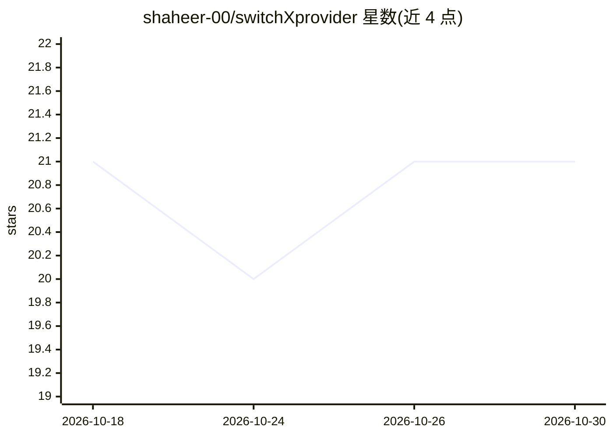

# shaheer-00/switchXprovider

⭐ 21 · JavaScript · MIT · 推送 2026-10-18 · [GitHub](https://github.com/shaheer-00/switchXprovider) · 个人维护

**Claude Code 本地多供应商代理插件：自动故障转移与用量分析**

零依赖的 Claude Code 插件，在本地启动代理把 API 流量路由到任意 Anthropic 或 OpenAI 兼容端点（GLM、DeepSeek、Kimi、Gemini、OpenRouter、自建网关等）。按优先级路由，请求失败自动重试下一供应商并按错误类型施加冷却，宕机供应商每 30 秒重探测自动回归；代理从响应中读取 token 用量做分供应商/模型/日统计与估算成本，附仪表盘、价格编辑器、可分享统计卡与免费供应商目录。要求 Node>=18，支持插件市场或 git clone 安装。

## 筛选速览

| 维度 | 判定 | 备注 |
|---|---|---|
| AI 角色 | `ai-ecosystem` | LLM/agent 周边工具 |
| 许可风险 | `permissive` | MIT |
| 部署形态 | `None` |  |
| 模型依赖 | — | README 未给出锁定关系 |
| 硬件要求 | — | 无带数字的原话,不猜 |
| 安装摩擦 | `low` | 无编译、无系统依赖或容器化 |
| 成熟度 | — | 结构信号不足 |

## 能力要点

- 按错误类型（401/402/429/5xx/超时）自动故障转移与指数冷却（最高 8×）
- 每 30 秒健康探测，宕机供应商自动回归轮转
- 零依赖、单 Node 进程、约 12 个文件
- 分供应商/模型/日的 token、延迟、成功率与估算成本分析，附仪表盘

## 适用场景

- 供应商宕机时让 Claude Code 自动切换到备用端点不中断编码
- 把官方 Claude Code 接到 GLM/DeepSeek 等免费或自有端点
- 查看各供应商与模型的 token 消耗与估算成本

## 场景标签

`模型网关` `LLM 可观测性` · 领域:Agent 开发

## 证据(README 行号)

> L5: A zero-dependency Claude Code plugin that routes your API traffic through a local
> L6: proxy with automatic failover, auto-recovery, live usage analytics — and
> L9: Works with any Anthropic- or OpenAI-compatible endpoint — GLM, DeepSeek, Kimi, Gemini,

## 星数曲线

2026-10-18 21 → 2026-10-30 21（+0）

---
*卡片 v1 · prompt 1.4 · 生成 2026-10-28 · 置信度 high · 依据 README sha `fa56b4d486de` · [字段定义](../../DATASET.md)*
