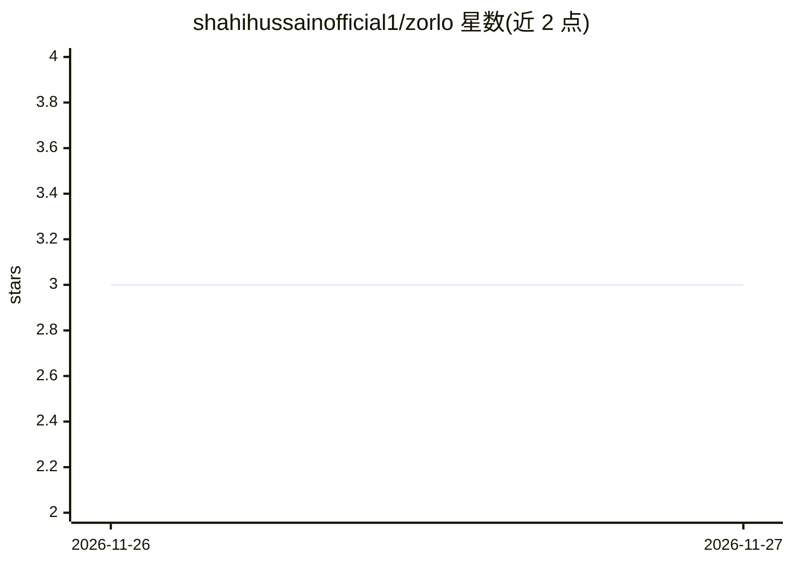

# shahihussainofficial1/zorlo

⭐ 3 · C++ · Apache-2.0 · 推送 2026-11-23 · [GitHub](https://github.com/shahihussainofficial1/zorlo) · [官网](https://zorlo.stream) · 个人维护

**低配 CPU PC 用 SSD 流式读取专家运行大 MoE 模型**

C++17 编写的 MoE 推理引擎：将注意力、路由器等常驻权重留在 RAM，专家权重留在 SSD，按 token 路由按需并行读取进自适应缓存，从而在 4-8 GB 内存、仅 CPU 的 Windows PC 上运行 30B 级模型。默认输出与 llama.cpp 逐 token 一致，另提供可开关的有损加速模式并给出质量测量。附带 OpenAI/Anthropic 兼容服务器和含编码 agent 的 Windows 桌面应用，需 AVX2 CPU 与 NVMe SSD。

## 筛选速览

| 维度 | 判定 | 备注 |
|---|---|---|
| AI 角色 | `ai-native` | 本体是模型或模型工具 |
| 许可风险 | `permissive` | Apache-2.0 |
| 部署形态 | `desktop` | 安装包/桌面程序 |
| 模型依赖 | local-ok | 支持本地模型 |
| 硬件要求 | — | 无带数字的原话,不猜 |
| 安装摩擦 | `medium` | 含编译或系统依赖之一 |
| 成熟度 | `idea` | |

## 能力要点

- 专家从 SSD 流式读取，常驻部分驻留 RAM，缓存随空闲内存伸缩
- 默认输出与 llama.cpp 逐 token/逐 logit 一致，用 golden 测试集校验
- 提供 OpenAI/Anthropic 兼容服务器（流式、工具调用、-np 并发）
- Zorlo Desktop：模型下载、聊天与带权限控制/MCP 的编码 agent

## 适用场景

- 在没有独显、内存只有 8 GB 的笔记本上本地跑 30B MoE 模型
- 本地起一个 OpenAI 兼容接口给现有客户端或 agent 使用
- 用 Desktop 的 agent 模式让模型读写项目文件夹

## 场景标签

`推理引擎` · 领域:训练与推理

## 证据(README 行号)

> L3: **Run large Mixture-of-Experts language models on an ordinary PC: CPU only, from 4-8 GB of RAM.**
> L13: A 30B model doesn't fit in 8 GB of RAM, but a Mixture-of-Experts model only uses a small part of
> L52: - **An OpenAI- and Anthropic-compatible server:** `zorlo serve` supports streaming, tool calls, reasoning

## 星数曲线

2026-11-26 3 → 2026-11-27 3（+0）

---
*卡片 v1 · prompt 1.4 · 生成 2026-11-27 · 置信度 high · 依据 README sha `ad560899ff0d` · [字段定义](../../DATASET.md)*
