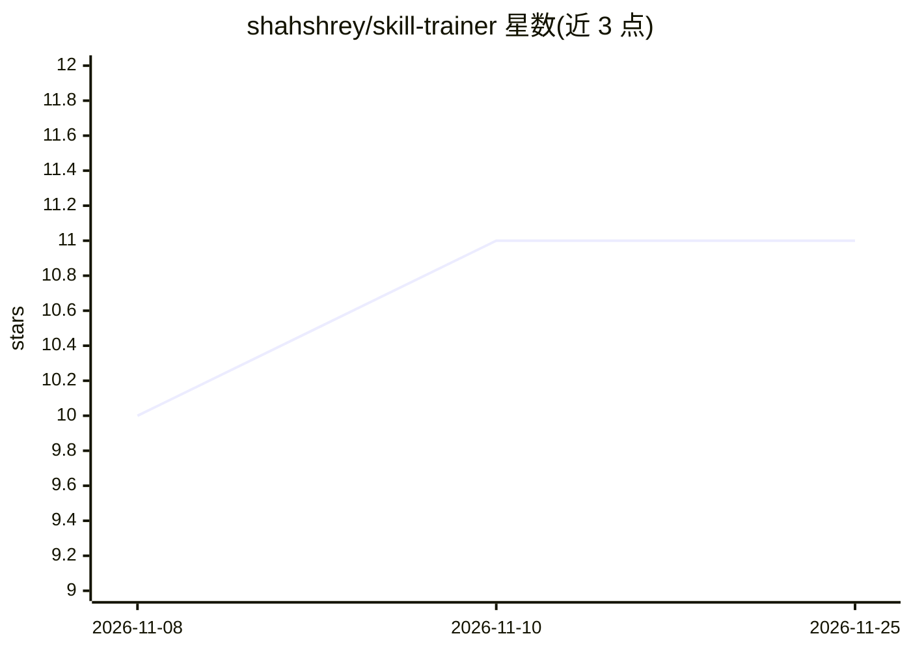

# shahshrey/skill-trainer

⭐ 11 · Python · MIT · 推送 2026-10-04 · [GitHub](https://github.com/shahshrey/skill-trainer) · 个人维护

**训练 agent SKILL.md 技能文件的爬山循环框架**

skill-trainer 是一个以 agent 驱动的爬山优化循环：编辑 agent 对 SKILL.md 提出小幅修改，管理 agent 提交候选，并行 rollout worker 在编辑者不可见的留出验证集上运行任务，score.py 打分，仅当分数严格提升才保留修改，否则 git reset --hard 回滚并将失败编辑存入缓冲供后续参考。框架本体为纯 Python（依赖 LangChain 与 Pydantic），通过已安装的 agent CLI（claude/codex/copilot/cursor-agent/opencode）执行 rollout 与编辑，带 train.sh 自动重启与断点恢复机制，训练结果落在 git 分支与 results.tsv。

## 筛选速览

| 维度 | 判定 | 备注 |
|---|---|---|
| AI 角色 | `ai-ecosystem` | LLM/agent 周边工具 |
| 许可风险 | `permissive` | MIT |
| 部署形态 | `library` | 以包/库形式分发 |
| 模型依赖 | — | README 未给出锁定关系 |
| 硬件要求 | — | 无带数字的原话,不猜 |
| 安装摩擦 | `low` | 无编译、无系统依赖或容器化 |
| 成熟度 | — | 结构信号不足 |

## 能力要点

- 编辑 agent 只见训练任务，验证集留出作门禁，防泄漏由结构保证
- git 作为检查点机制：接受编辑为 commit，拒绝则 reset --hard
- 五种内置评分模式（exact/checklist/command/rubric/judge），前四种无 LLM 调用
- train.sh 自动重启管理 agent，支持从磁盘状态恢复长时训练

## 适用场景

- 把 agent 反复出错的常见请求整理成任务套件，迭代训练对应 SKILL.md
- 为技能文件建立可度量、可回滚的优化流程
- 用 LLM judge 模式处理无法确定性评分的技能（如文案、评审质量）

## 场景标签

`提示工程` · 领域:Agent 开发

## 证据(README 行号)

> L7: An agent-driven hill-climbing loop that trains skill files against scored
> L11: Works with Claude Code, Codex, GitHub Copilot, Cursor, and opencode. Your
> L26: The harness is plain Python with one `pip install -r requirements.txt`

## 星数曲线

2026-11-08 10 → 2026-11-25 11（+1）

---
*卡片 v1 · prompt 1.4 · 生成 2026-11-18 · 置信度 high · 依据 README sha `ce888871b23d` · [字段定义](../../DATASET.md)*
