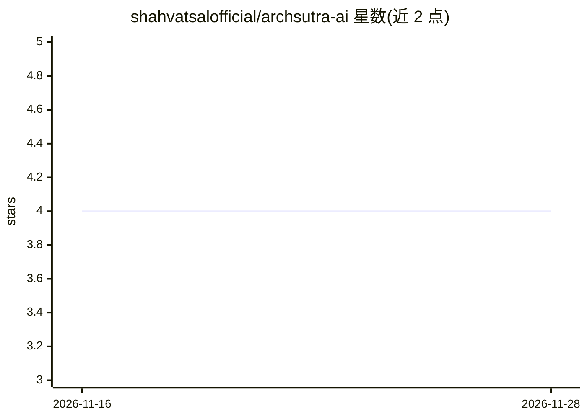

# shahvatsalofficial/archsutra-ai

⭐ 4 · TypeScript · Apache-2.0 · 推送 2026-11-27 · [GitHub](https://github.com/shahvatsalofficial/archsutra-ai) · [官网](https://shahvatsalofficial.github.io/archsutra-ai/) · 个人维护

**给开发者的软件架构审计 agent：基于 IDE 自带模型做审查与设计**

面向使用 Claude Code、Cursor、Codex、GitHub Copilot、Gemini CLI 的开发者，提供可移植的 Agent Skills、12 个专家角色（ArchSutra Prime 领队）与一个确定性离线 CLI。CLI 零运行时依赖、默认只读、无遥测，可对仓库做映射、审计（19 条规则，含密钥/注入/TLS/容器/IaC 检查）、生成 Markdown/HTML/JSON/SARIF 报告，每条结论标注 observed/inferred/proposed/unknown 并引用 file:line 证据；设计、威胁建模（STRIDE）、迁移规划等叙事报告由 IDE 内模型经技能完成，不调用额外 API。README 公布了在 52 个真实仓库上人工标注的精确率基线与改进结果及其局限。

## 筛选速览

| 维度 | 判定 | 备注 |
|---|---|---|
| AI 角色 | `ai-enhanced` | 去掉 AI 部分产品仍成立 |
| 许可风险 | `permissive` | Apache-2.0 |
| 部署形态 | `library` | 以包/库形式分发 |
| 模型依赖 | — | README 未给出锁定关系 |
| 硬件要求 | — | 无带数字的原话,不猜 |
| 安装摩擦 | `low` | 无编译、无系统依赖或容器化 |
| 成熟度 | `idea` | |

## 能力要点

- 确定性离线 CLI：0 运行时依赖、只读默认、无遥测，报告含 file:line 证据与稳定规则 ID
- 复用 IDE 自带模型，无需额外 API key；五个 AI IDE 的幂等可逆安装
- 输出 Markdown/HTML/JSON/SARIF 2.1.0，可接入 GitHub code scanning 与 CI（--fail-on）
- 公布 52 仓库人工标注的精确率数据（基线 50%→复测 95%）及方法局限

## 适用场景

- 在写代码的 AI IDE 里对当前仓库做第一遍架构审计
- 在 CI 中用 --fail-on high 拦截高危发现并上传 SARIF
- 对单体仓库生成 C4 图、威胁模型与迁移路线图
- 为新项目做绿地设计与 ADR 建议

## 场景标签

`代码审查` `网络安全` · 领域:编码与开发

## 证据(README 行号)

> L17: ArchSutra AI is an open-source **software architecture agent**. It ships portable Agent Skills, twelve specialist a
> L60: |Architecture audit: severity, confidence, `file:line` evidence|`archsutra audit` + `architecture-audit` skill|CLI 
> L69: |Safe, reversible install into 5 AI IDEs|`archsutra install` / `uninstall`|No|

## 星数曲线

2026-11-16 4 → 2026-11-28 4（+0）

---
*卡片 v1 · prompt 1.4 · 生成 2026-11-21 · 置信度 high · 依据 README sha `862f919a060d` · [字段定义](../../DATASET.md)*
