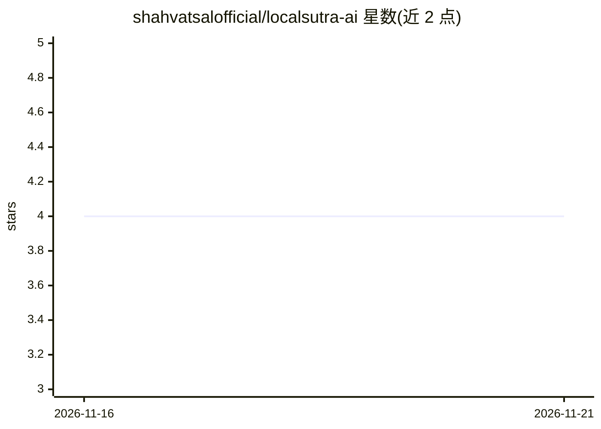

# shahvatsalofficial/localsutra-ai

⭐ 4 · HTML · Apache-2.0 · 推送 2026-11-17 · [GitHub](https://github.com/shahvatsalofficial/localsutra-ai) · [官网](https://shahvatsalofficial.github.io/localsutra-ai/) · 个人维护

**本地 AI 就绪度 CLI：检测硬件、估算模型适配、诊断本地运行时**

离线优先的命令行工具，回答在个人机器上运行 LLM 前的常见问题：doctor 采集硬件画像（CPU/RAM/磁盘/NVIDIA GPU），fit 按启发式公式估算模型内存与 VRAM 适配，probe 检测 127.0.0.1 上的 Ollama/llama.cpp 服务状态，infer 对已装模型计时，benchmark 为纯 CPU 循环（非推理）。另含 37 项对抗性自检的 audit 命令（输出 HTML/MD/JSON）、SHA-256 报告校验、25 个可移植 Agent Skills 安装器。零 npm 依赖，需 Node 22+，仅回环网络访问。

## 筛选速览

| 维度 | 判定 | 备注 |
|---|---|---|
| AI 角色 | `ai-ecosystem` | LLM/agent 周边工具 |
| 许可风险 | `permissive` | Apache-2.0 |
| 部署形态 | `library` | 以包/库形式分发 |
| 模型依赖 | local-ok | 支持本地模型 |
| 硬件要求 | — | 无带数字的原话,不猜 |
| 安装摩擦 | `low` | 无编译、无系统依赖或容器化 |
| 成熟度 | — | 结构信号不足 |

## 能力要点

- doctor/fit/probe/infer/benchmark 等命令覆盖硬件画像到运行时诊断
- 每个结果标注 measured/estimated/unknown 等诚实标签
- 37 项对抗性检查的独立审计报告（HTML/Markdown/JSON）
- 25 个可移植 Agent Skills，支持 6 种 IDE 布局

## 适用场景

- 买新机器或升级前判断能否本地跑某参数量级模型
- 检查本机 Ollama/llama.cpp 服务是否真的只在回环地址
- 为自己的模型生成可复验、带 SHA-256 封存的基准与审计报告

## 场景标签

 · 领域:LLM 基础设施/本地推理诊断

## 证据(README 行号)

> L13: **LocalSutra AI** is an offline-first command-line tool that answers the questions people ask before running an LLM
> L34: |`probe --runtime ollama\|llama`|Is a loopback Ollama/llama.cpp server up, which models are listed, stable failure 

## 星数曲线

2026-11-16 4 → 2026-11-21 4（+0）

---
*卡片 v1 · prompt 1.4 · 生成 2026-11-21 · 置信度 high · 依据 README sha `bf40b3fb06b0` · [字段定义](../../DATASET.md)*
