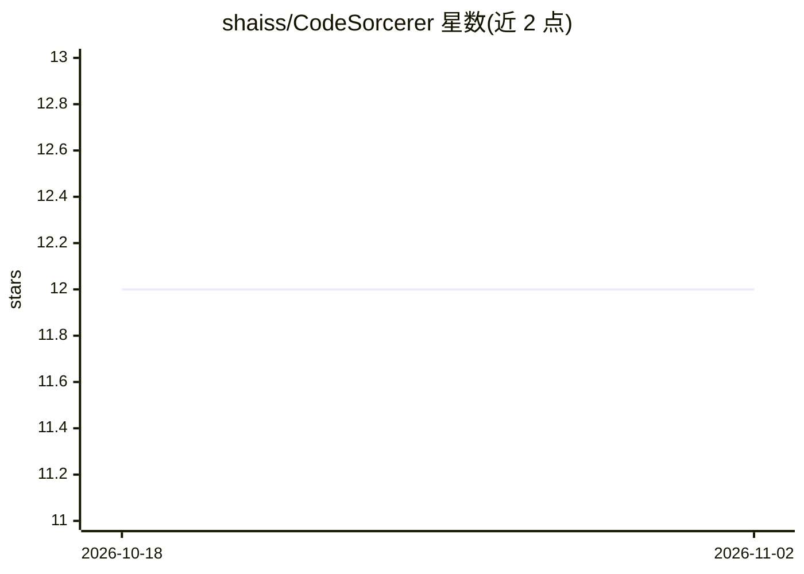

# shaiss/CodeSorcerer

⭐ 12 · TypeScript · 推送 2025-12-02 · [GitHub](https://github.com/shaiss/CodeSorcerer) · [官网](https://replit.com/@ShaiPerednik/Code-Sorcerer) · 个人维护

**用 AI 对代码仓库做多维度审计评分的工具**

面向软件项目评审场景的代码审计工具：读取本地仓库或 GitHub 项目，调用 OpenAI GPT-4.1 按代码质量、功能性、安全、创新、文档、UX、区块链集成七个类别生成带评分与反馈的 Markdown 报告。架构上由 Flask Web 界面、审计引擎、仓库 Provider、AI 客户端、类别处理器与报告生成器组成，也支持命令行运行，通过 TOML 文件配置类别与评分标准。运行需 Python 3.7+、Git 与 OpenAI API key。默认配置名（near_hackathon）与区块链集成类别表明其与 NEAR 生态黑客松评审相关。

## 筛选速览

| 维度 | 判定 | 备注 |
|---|---|---|
| AI 角色 | `ai-native` | 本体是模型或模型工具 |
| 许可风险 | `permissive` | — |
| 部署形态 | `library` | 以包/库形式分发 |
| 模型依赖 | — | README 未给出锁定关系 |
| 硬件要求 | — | 无带数字的原话,不猜 |
| 安装摩擦 | `low` | 无编译、无系统依赖或容器化 |
| 成熟度 | — | 结构信号不足 |

## 能力要点

- 支持本地仓库与 GitHub 项目作为审计对象
- GPT-4.1 按 7 个类别生成带评分的 Markdown 报告
- Flask Web 界面与实时进度跟踪，另有 CLI 用法
- TOML 配置文件可自定义类别与评分标准

## 适用场景

- 黑客松/项目评审中批量生成代码评分报告
- 审计智能合约与区块链项目的集成质量
- 从安全、文档等维度获取项目的 AI 分析报告

## 场景标签

`代码审查` · 领域:编码与开发

## 证据(README 行号)

> L9: A robust code auditing and analysis tool that leverages AI to evaluate software projects across multiple dimensions.
> L14: - **AI-Powered Evaluation**: Integrates with OpenAI GPT-4.1 for intelligent code analysis

## 星数曲线

2026-10-18 12 → 2026-11-02 12（+0）

---
*卡片 v1 · prompt 1.4 · 生成 2026-11-01 · 置信度 mid · 依据 README sha `cbb7cfa9ffef` · [字段定义](../../DATASET.md)*
