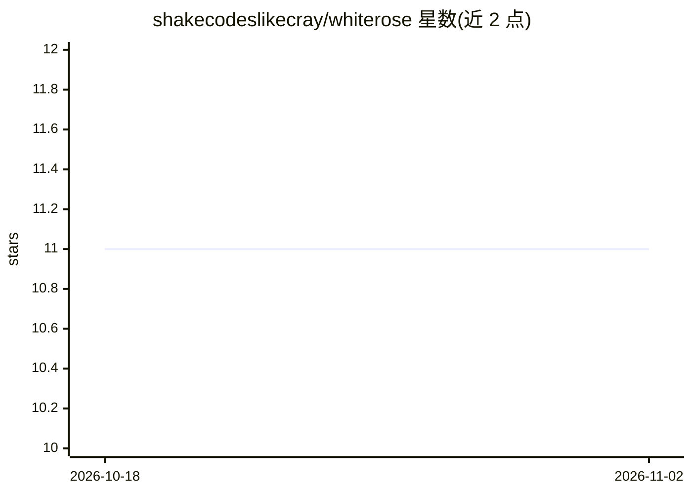

# shakecodeslikecray/whiterose

⭐ 11 · TypeScript · NOASSERTION · 推送 2026-02-13 · [GitHub](https://github.com/shakecodeslikecray/whiterose) · 个人维护

**复用已有 LLM 订阅执行 CLI 的 AI 找 bug 工具**

命令行 bug 检测工具，不直接调用模型 API，而是调用本地已安装的 LLM CLI（Claude Code、Codex、Gemini CLI、Aider、OpenCode）作为执行器，因此无需 API key、无额外费用。流程为先运行 tsc/eslint 等静态分析，再将静态信号注入提示词，执行 19 轮分阶段扫描，覆盖注入、鉴权绕过、空引用、异步等 12 类 bug；提供交互式 TUI 审阅并应用修复（agentic fix），输出 SARIF/Markdown/JSON。前提是用户至少已安装一种 LLM CLI。许可为 PolyForm Noncommercial（禁止商用）。

## 筛选速览

| 维度 | 判定 | 备注 |
|---|---|---|
| AI 角色 | `ai-ecosystem` | LLM/agent 周边工具 |
| 许可风险 | `none` | NOASSERTION |
| 部署形态 | `library` | 以包/库形式分发 |
| 模型依赖 | locked-api |  |
| 硬件要求 | — | 无带数字的原话,不猜 |
| 安装摩擦 | `low` | 无编译、无系统依赖或容器化 |
| 成熟度 | — | 结构信号不足 |

## 能力要点

- 复用已有 LLM CLI 订阅作为执行器，无需 API key
- 19 轮扫描管线，静态分析（tsc/eslint）信号先注入提示词
- 12 类 bug 覆盖（注入/鉴权绕过/异步/资源泄漏等）
- 交互式 TUI 审阅与 agentic 修复，输出 SARIF/Markdown/JSON

## 适用场景

- 在已有 Claude Code/Codex 订阅上对代码库做全量或增量 bug 扫描
- 将扫描结果以 SARIF 接入 VS Code 或 GitHub Code Scanning
- 交互式审阅并让 LLM 直接应用修复

## 场景标签

`代码审查` `编码 Agent` · 领域:编码与开发

## 证据(README 行号)

> L10: AI-powered bug hunter that uses your existing LLM subscription. No API keys needed. No extra costs.
> L45: You need at least one LLM CLI tool installed:
> L155: **Adding a new provider is trivial** - just implement the `PromptExecutor` interface (~30 lines).

## 星数曲线

2026-10-18 11 → 2026-11-02 11（+0）

---
*卡片 v1 · prompt 1.4 · 生成 2026-11-01 · 置信度 mid · 依据 README sha `a5dd596367e3` · [字段定义](../../DATASET.md)*
