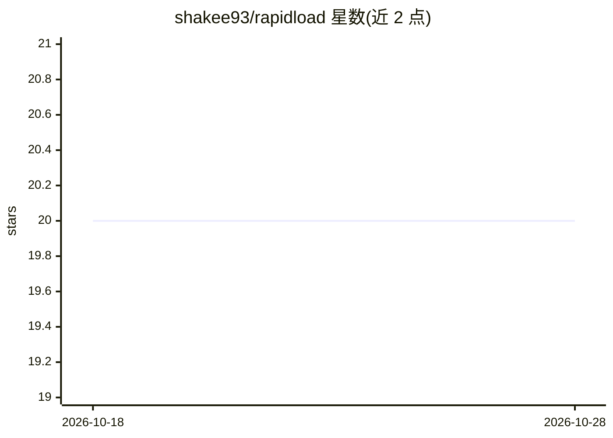

# shakee93/rapidload

⭐ 20 · TypeScript · GPL-3.0 · 推送 2026-10-12 · [GitHub](https://github.com/shakee93/rapidload) · [官网](https://rapidload.ai) · 组织维护

**AI 辅助的 WordPress 性能优化商业插件**

RapidLoad AI 是收费（premium）的 WordPress 性能优化插件，处理 CSS（未用规则移除、Critical CSS 生成、压缩）、JavaScript（延迟执行、压缩）、图片（自动压缩、WebP/AVIF 转换、懒加载）、字体与缓存，目标是提升 PageSpeed 分数。AI 部分包括性能瓶颈诊断、技术支持聊天与自动化优化决策。安装需先在 rapidload.ai 购买许可证，再上传插件并激活密钥。兼容 WordPress 5.0+、PHP 5.4+、常见页面构建器与 WooCommerce。

## 筛选速览

| 维度 | 判定 | 备注 |
|---|---|---|
| AI 角色 | `ai-enhanced` | 去掉 AI 部分产品仍成立 |
| 许可风险 | `viral` | GPL-3.0 |
| 部署形态 | `None` |  |
| 模型依赖 | — | README 未给出锁定关系 |
| 硬件要求 | — | 无带数字的原话,不猜 |
| 安装摩擦 | `low` | 无编译、无系统依赖或容器化 |
| 成熟度 | — | 结构信号不足 |

## 能力要点

- 未用 CSS 移除与 Critical CSS 自动生成
- 图片压缩、WebP/AVIF 转换与懒加载
- AI 诊断性能瓶颈与 AI 支持聊天
- 含 121 个边缘节点的企业 CDN 与缓存功能

## 适用场景

- 我需要自动清理 WordPress 站点的未用 CSS/JS 以提升 PageSpeed 分数
- 我想让插件自动做图片压缩与格式转换
- 我想通过 AI 诊断定位站点性能瓶颈

## 场景标签

`聊天机器人` · 领域:对话与助手

## 证据(README 行号)

> L26: RapidLoad AI is a premium WordPress optimization plugin that uses artificial intelligence to automatically optimize
> L30: - **AI-Powered Optimization**

## 星数曲线

2026-10-18 20 → 2026-10-28 20（+0）

---
*卡片 v1 · prompt 1.4 · 生成 2026-10-28 · 置信度 high · 依据 README sha `4ab8f195f750` · [字段定义](../../DATASET.md)*
