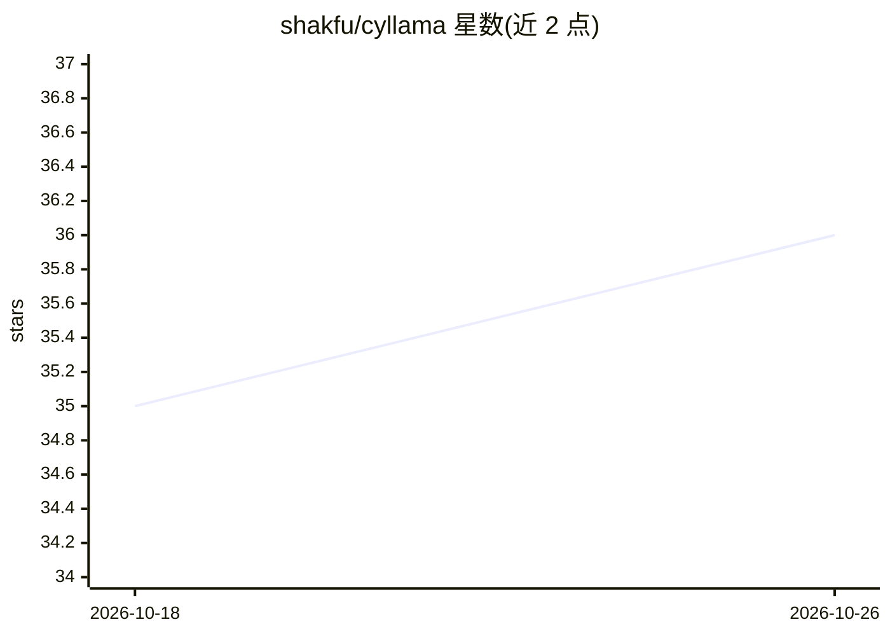

# shakfu/cyllama

⭐ 36 · Python · MIT · 推送 2026-10-17 · [GitHub](https://github.com/shakfu/cyllama) · [官网](https://shakfu.github.io/cyllama/) · 个人维护

**封装 llama.cpp/whisper.cpp/stable-diffusion.cpp 的本地跨模态推理 Python 库**

无硬依赖的 Python 本地推理库，以 Cython 封装 llama.cpp（文本生成、chat、嵌入、TTS）、whisper.cpp（语音转写与翻译）和 stable-diffusion.cpp（图像/视频生成）。提供高层 API、流式输出、批处理、投机解码、零依赖 Agent 框架（ReAct/Constrained/Contract 三种架构与多 Agent 组合）、RAG（含 sqlite-vector）及 OpenAI 兼容服务器。GPU 支持 Metal/CUDA/ROCm/Vulkan/SYCL，经 PyPI 分平台 wheel 安装，sycl 变体需 Intel oneAPI 运行时且无 CPU 回退。

## 筛选速览

| 维度 | 判定 | 备注 |
|---|---|---|
| AI 角色 | `ai-native` | 本体是模型或模型工具 |
| 许可风险 | `permissive` | MIT |
| 部署形态 | `library` | 以包/库形式分发 |
| 模型依赖 | local-ok | 支持本地模型 |
| 硬件要求 | — | 无带数字的原话,不猜 |
| 安装摩擦 | `medium` | 含编译或系统依赖之一 |
| 成熟度 | — | 结构信号不足 |

## 能力要点

- Cython 封装三大 .cpp 推理栈，零硬依赖
- 三种 Agent 架构与多 Agent 组合（agent_as_tool / TieredAgentTeam），工具参数支持 JSON-Schema 约束
- 内置 RAG，支持四种可插拔 PDF 解析后端与多种向量库
- OpenAI 兼容嵌入式服务器与 LangChain 集成

## 适用场景

- 在 Python 中本地运行文本生成、转写与文生图/视频
- 搭建带工具调用的本地 Agent 或多 Agent 团队
- 以本地嵌入与 sqlite-vector 构建离线 RAG 文档问答
- 快速起一个 OpenAI 兼容的本地推理服务

## 场景标签

`推理引擎` `Agent 框架` `RAG` `图像生成` · 领域:Agent 开发

## 证据(README 行号)

> L3: cyllama is a no-dependencies Python library for local AI inference built on the `.cpp` inference stack:
> L5: - **llama.cpp** - Text generation, chat, embeddings, and text-to-speech
> L7: - **whisper.cpp** - Speech-to-text transcription and translation
> L9: - **stable-diffusion.cpp** - Image and video generation

## 星数曲线

2026-10-18 35 → 2026-10-26 36（+1）

---
*卡片 v1 · prompt 1.4 · 生成 2026-10-25 · 置信度 high · 依据 README sha `fc0f4316a776` · [字段定义](../../DATASET.md)*
