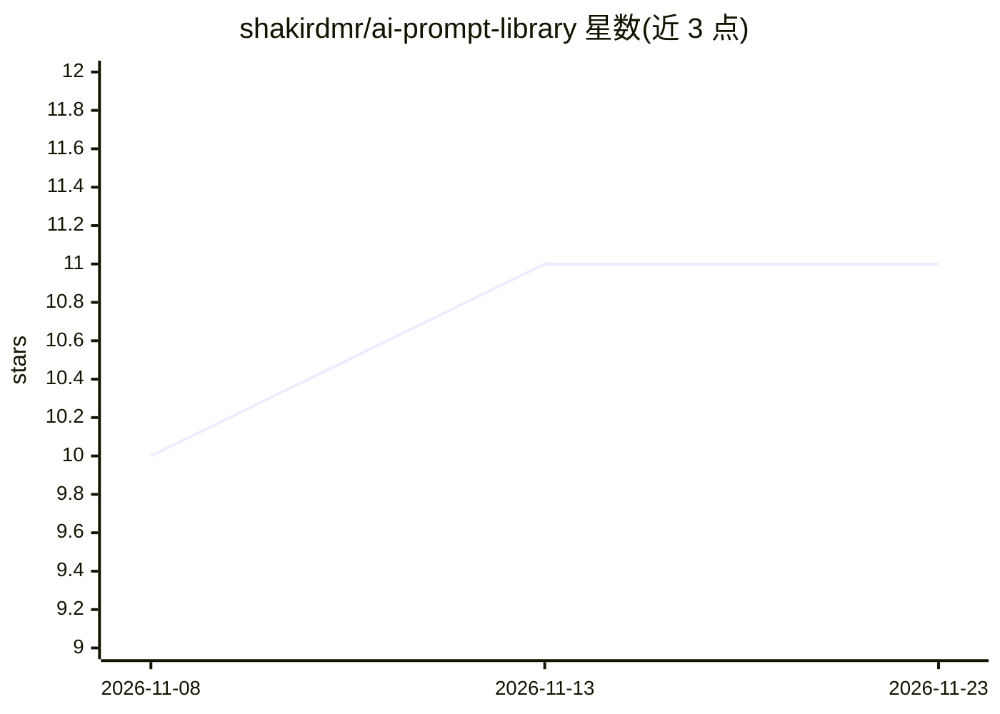

# shakirdmr/ai-prompt-library

⭐ 11 · HTML · MIT · 推送 2026-11-18 · [GitHub](https://github.com/shakirdmr/ai-prompt-library) · [官网](https://promptitin.com) · 个人维护

**面向 AI 使用者的 200+ 可复制提示词库**

按类别组织的提示词集合，覆盖图像/视频生成、求职、简历、薪资谈判、SEO 等场景，每条提示词标注目标模型与画幅比例，图像类条目附结果页面、提示词逐部分解析与变体。提示词统一采用五部分结构（角色/上下文/任务/约束/输出格式）加核验脚注。以 Markdown 仓库形式提供，配套网站浏览与 PromptIt Chrome 扩展，每月更新，MIT 许可，接受 PR。

## 筛选速览

| 维度 | 判定 | 备注 |
|---|---|---|
| AI 角色 | `ai-knowledge` | 知识聚合/清单类 |
| 许可风险 | `permissive` | MIT |
| 部署形态 | `None` |  |
| 模型依赖 | — | README 未给出锁定关系 |
| 硬件要求 | — | 无带数字的原话,不猜 |
| 安装摩擦 | `low` | 无编译、无系统依赖或容器化 |
| 成熟度 | — | 结构信号不足 |

## 能力要点

- 200+ 提示词按 8 个类别组织，每条标注适配模型
- 五部分提示词结构模板（角色/上下文/任务/约束/输出格式）
- 图像与视频类提示词附生成结果与逐段解析
- 配套浏览网站与 PromptIt Chrome 扩展

## 适用场景

- 我在 Gemini/ChatGPT 上生成个人写真或节日照片时直接复制提示词
- 我找工作时找简历与求职相关的提示词模板
- 我想学提示词结构化写法时参考逐部分解析

## 场景标签

`提示工程` `图像生成` · 领域:Agent 开发

## 证据(README 行号)

> L1: AI Prompt Library — 200+ copy-paste prompts for ChatGPT, Claude, Gemini and Midjourney
> L41: |Category|Prompts|Best with|
> L43: |📸 **Image & Video Prompts with Results** **NEW**|104|Nano Banana, ChatGPT, Midjourney, FLUX · Veo, Sora, Kling, Ru

## 星数曲线

2026-11-08 10 → 2026-11-23 11（+1）

---
*卡片 v1 · prompt 1.4 · 生成 2026-11-19 · 置信度 high · 依据 README sha `8a32ef9a4b28` · [字段定义](../../DATASET.md)*
