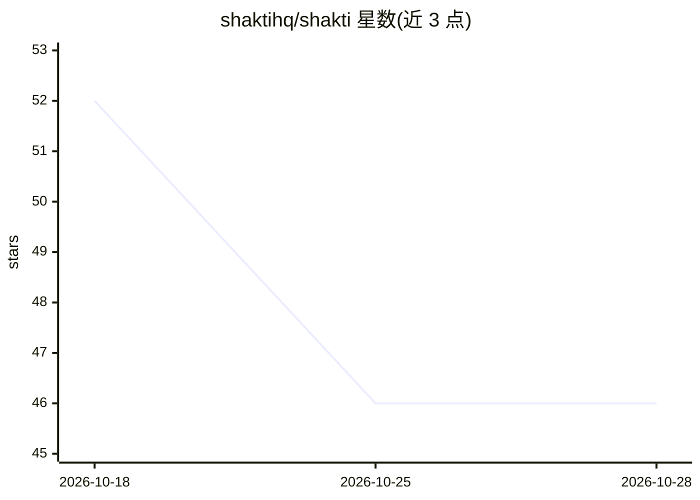

# shaktihq/shakti

⭐ 46 · HTML · MIT · 推送 2026-08-19 · [GitHub](https://github.com/shaktihq/shakti) · [官网](https://shakti.adityabhat.in) · 个人维护

**AI-first Python Web 框架：一体化构建 API、Web 应用与 AI 功能**

基于 async ASGI 的开源 Python Web 框架，单次安装内提供路由、SQLAlchemy 异步 ORM 与 Alembic 自动迁移、JWT/RBAC/API key 认证、自动生成的 Admin 面板、后台任务队列、监控面板与缓存等模块。AI 部分内置 Claude（Anthropic）与 OpenAI 支持，覆盖 chat/completion/流式、RAG、带工具调用的 agent、提示词模板，以及 PDF 提取、Claude Vision OCR、文档问答等 Document AI 功能，并自动注册 /ai/* 系列 API 端点。通过 pip 安装，提供 shakti CLI 脚手架、代码生成与多种 extras 安装选项。

## 筛选速览

| 维度 | 判定 | 备注 |
|---|---|---|
| AI 角色 | `ai-ecosystem` | LLM/agent 周边工具 |
| 许可风险 | `permissive` | MIT |
| 部署形态 | `library` | 以包/库形式分发 |
| 模型依赖 | locked-api |  |
| 硬件要求 | — | 无带数字的原话,不猜 |
| 安装摩擦 | `low` | 无编译、无系统依赖或容器化 |
| 成熟度 | — | 结构信号不足 |

## 能力要点

- 内置 Claude（Anthropic）与 OpenAI 集成，含 chat/流式/RAG/agent 工具调用
- 单次安装提供 ORM、JWT 认证、Admin 面板、后台任务、监控等模块
- shakti CLI 脚手架与一键生成模型及 CRUD 端点
- Document AI：PDF 提取、Claude Vision OCR、文档问答与结构化抽取

## 适用场景

- 快速搭建含 AI chat/RAG/agent 能力的生产 API 与 Web 应用
- 用自动生成的 Admin 面板管理数据模型
- 为文档构建问答与结构化抽取服务

## 场景标签

 · 领域:Web 开发框架/AI 应用后端

## 证据(README 行号)

> L11: **Shakti** is an open-source, **AI-first Python web framework** for building modern APIs, web applications, AI agen
> L52: - Built-in Claude (Anthropic) and OpenAI support
> L179: |AI|`from shakti.ai import AI`|Claude/OpenAI, RAG, agents|

## 星数曲线

2026-10-18 52 → 2026-10-28 46（-6）

---
*卡片 v1 · prompt 1.4 · 生成 2026-10-25 · 置信度 high · 依据 README sha `e6936c9fccd9` · [字段定义](../../DATASET.md)*
