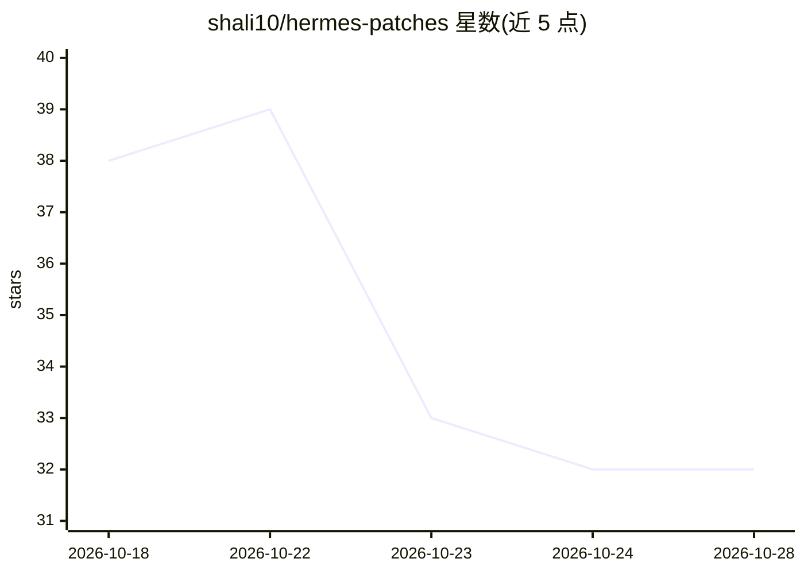

# shali10/hermes-patches

⭐ 32 · Python · MIT · 推送 2026-10-20 · [GitHub](https://github.com/shali10/hermes-patches) · [官网](https://github.com/shali10/hermes-patches) · 个人维护 · 中文 README

**给 Hermes Agent 用户的非侵入式体验增强补丁套件**

面向自部署 Hermes Agent 的运维者/开发者，通过 AST 级代码注入与 systemd 生命周期预检，向 Hermes 源码应用 10 项补丁：Token 消耗全量页脚、Telegram 原生 Markdown 表格放行、命令菜单汉化、SQLite busy_timeout 与外键自愈、低风险审批自动放行、流式静默与 429 频控防护、思考链标签净化、4096 长消息切分、失效 workdir 回退与 state.db 防删护栏。提供 pip/pipx、一键脚本、交互式中文控制台三种安装方式，支持 --uninstall 一键回滚与 .bak 备份，要求 Python 3.10+。

## 筛选速览

| 维度 | 判定 | 备注 |
|---|---|---|
| AI 角色 | `ai-ecosystem` | LLM/agent 周边工具 |
| 许可风险 | `permissive` | MIT |
| 部署形态 | `library` | 以包/库形式分发 |
| 模型依赖 | — | README 未给出锁定关系 |
| 硬件要求 | — | 无带数字的原话,不猜 |
| 安装摩擦 | `low` | 无编译、无系统依赖或容器化 |
| 成熟度 | — | 结构信号不足 |

## 能力要点

- 10 项补丁覆盖 Token 计量、CJK 表格、菜单汉化、SQLite 自愈与防删护栏等
- 非侵入式 AST 注入，修改前经 py_compile 编译预检与原子置换
- 支持 .bak 备份与 --uninstall 一键无损回滚，操作幂等
- 提供 pip/pipx、curl 一键脚本、交互式中文控制台多种安装途径

## 适用场景

- 自部署 Hermes Agent 时增加 Token 用量与缓存命中的可见性
- Telegram 端解决中文表格被拦截、429 限流与长消息截断问题
- 生产环境加固 SQLite 稳定性并防止误删 state.db

## 场景标签

 · 领域:AI Agent 运维工具

## 证据(README 行号)

> L3: > **Non-intrusive Turnkey Production Enhancement Patches for Hermes Agent**
> L96: `hermes-patches` 采用 **非侵入式 AST 级安全代码注入** 与 **服务级生命周期预检守护**：
> L179: |`footer`|`runtime-footer`, `token`, `stats`|`gateway/runtime_footer.py` `gateway/run.py`|渲染 Prompt 总量、缓存命中、输出 Tok

## 星数曲线

2026-10-18 38 → 2026-10-28 32（-6）

---
*卡片 v1 · prompt 1.4 · 生成 2026-10-25 · 置信度 high · 依据 README sha `822f535639c4` · [字段定义](../../DATASET.md)*
