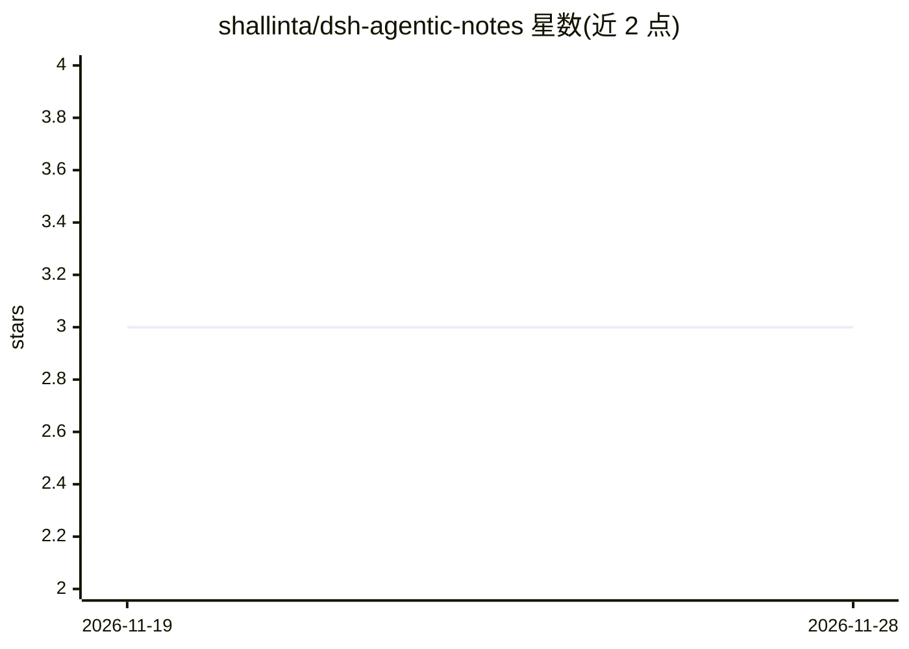

# shallinta/dsh-agentic-notes

⭐ 3 · JavaScript · MIT · 推送 2026-11-26 · [GitHub](https://github.com/shallinta/dsh-agentic-notes) · 个人维护 · 中文 README

**DSH 本地笔记插件：随手记、AI 自动归档与成文**

随记是 DSH 桌面端/Web 端的笔记插件，功能覆盖日记、主题笔记本、便笺、待办与提醒。记录时只写一句话，先进当日日记，再由 AI 生成归档方案，确认后写入笔记本；归错可一键改归属。`/agent` 指令让 AI 读取当前页面上下文，执行合并、改写、排序、标签等笔记管理操作，批量操作需确认且可撤销。内置本地 HTTP MCP 服务与 suiji-note 技能连接器（需 Python 3.8+），供外部 AI 会话读写本地 Markdown。模型能力依赖 DSH 已配置的 provider，插件本身不保存 API Key。README 声明当前为不稳定版本，正在重构。

## 筛选速览

| 维度 | 判定 | 备注 |
|---|---|---|
| AI 角色 | `ai-enhanced` | 去掉 AI 部分产品仍成立 |
| 许可风险 | `permissive` | MIT |
| 部署形态 | `None` |  |
| 模型依赖 | — | README 未给出锁定关系 |
| 硬件要求 | — | 无带数字的原话,不猜 |
| 安装摩擦 | `low` | 无编译、无系统依赖或容器化 |
| 成熟度 | — | 结构信号不足 |

## 能力要点

- 先落日记、AI 生成归档方案、确认后写入的三步记录流程
- `/agent` 可操作笔记、笔记本、待办、便笺与设置，支持整批撤销
- 内置本地 HTTP MCP 服务，外部 AI 会话可读写本地 Markdown
- 笔记为普通 .md 文件，配套清单文件可整体迁移备份

## 适用场景

- 随手记录灵感，稍后由 AI 归档到合适笔记本
- 积累素材后让 AI 合并、改写成文章或周复盘
- 把 AI 会话里的查证结论通过 MCP 沉淀为可检索笔记
- 在本地 Markdown 体系里统一管理日记、待办与便笺

## 场景标签

`知识库管理` · 领域:知识与检索

## 证据(README 行号)

> L11: 随记是 DSH 的本地笔记插件。随手记一句，先落进今天的日记，再由 AI 归档到合适的笔记本；素材够了，让 `/agent` 读取已有内容，把零散想法整理成文章。通过 MCP，AI 会话里的结论也能直接写进随记。笔记始终是本地 M
> L74: 随记是 DSH 插件，需要先有 DSH 桌面端或 Web 端。
> L483: 随记的 AI 功能依赖 DSH 的模型服务。

## 星数曲线

2026-11-19 3 → 2026-11-28 3（+0）

---
*卡片 v1 · prompt 1.4 · 生成 2026-11-21 · 置信度 mid · 依据 README sha `b6b9402aa4e9` · [字段定义](../../DATASET.md)*
