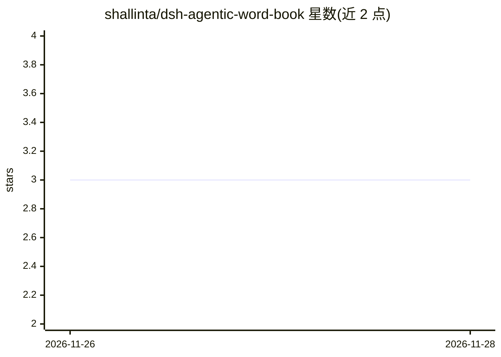

# shallinta/dsh-agentic-word-book

⭐ 3 · JavaScript · MIT · 推送 2026-11-26 · [GitHub](https://github.com/shallinta/dsh-agentic-word-book) · 个人维护 · 中文 README

**英语学习者的本地单词本插件，AI 一句话生成词卡**

DSH 侧栏插件形式的单词本：每词一页展示插图、音标、4 档倍速发音、常用词组与例句，配套挖字母拼写练习与 12 种题型的单词辨析。加词时通过「+单词」把输入交给 DSH 里的 AI，由其生成词条、插图与发音；技能脚本用 macOS `say`/Windows System.Speech 合成音频。词库、插图、发音均存本地目录，插件不上传数据、无遥测，备份即复制目录。安装方式是把安装指令发给 DSH 或经插件市场安装。

## 筛选速览

| 维度 | 判定 | 备注 |
|---|---|---|
| AI 角色 | `ai-enhanced` | 去掉 AI 部分产品仍成立 |
| 许可风险 | `permissive` | MIT |
| 部署形态 | `None` |  |
| 模型依赖 | — | README 未给出锁定关系 |
| 硬件要求 | — | 无带数字的原话,不猜 |
| 安装摩擦 | `low` | 无编译、无系统依赖或容器化 |
| 成熟度 | — | 结构信号不足 |

## 能力要点

- AI 加词：输入单词即生成词条、插图、词组、例句与发音
- 挖字母拼写练习与 12 种题型轮换的单词辨析
- 词库/插图/发音全为本地文件，代码与数据分离，无遥测
- 三套内置主题，标题/背景图/字体可自定义，卡片可多选打标筛选

## 适用场景

- 背单词时让 AI 一句话建好带插图和发音的词卡
- 用拼写练习和辨析题巩固刚学的单词
- 本地管理词库并随设备迁移备份

## 场景标签

`AI 助手` `语音合成` · 领域:对话与助手

## 证据(README 行号)

> L11: 一个词一页：插图、音标、发音、常用词组、例句都在上面，还有挖字母拼写练习和单词辨析选择题。切走再切回来，进度还在。
> L27: 点「+单词」输入想加的内容，剩下的交给 AI：词条、插图、五条词组、例句和发音一次做完。
> L35: 词条、插图、发音都是本地文件，住在一个目录里。插件包只带功能代码，不带词库。换电脑时把目录搬走即可。

## 星数曲线

2026-11-26 3 → 2026-11-28 3（+0）

---
*卡片 v1 · prompt 1.4 · 生成 2026-11-26 · 置信度 high · 依据 README sha `6b951c2ee483` · [字段定义](../../DATASET.md)*
