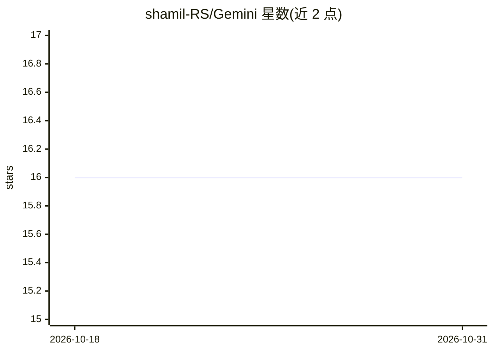

# shamil-RS/Gemini

⭐ 16 · Kotlin · 推送 2026-03-22 · [GitHub](https://github.com/shamil-RS/Gemini) · 个人维护

**Android 端 Gemini AI 助手应用，Kotlin/Compose 编写**

面向最终用户的 Android 应用，接入 Google Gemini 提供自然语言问答、推荐与日常任务自动化等 AI 助手功能。技术栈为 Kotlin，使用 Jetpack Compose 构建 UI、Dagger-Hilt 依赖注入、Room 本地存储、Coroutines/Flow 做异步与流式处理，Navigation3 负责页面导航。README 未列出具体模型配置或 API 接入细节；安装方式为克隆源码后在 Android Studio 中编译运行，无安装包或 Docker 提供。同时定位为现代 Android 架构的学习示例。

## 筛选速览

| 维度 | 判定 | 备注 |
|---|---|---|
| AI 角色 | `ai-native` | 本体是模型或模型工具 |
| 许可风险 | `none` | — |
| 部署形态 | `None` |  |
| 模型依赖 | — | README 未给出锁定关系 |
| 硬件要求 | — | 无带数字的原话,不猜 |
| 安装摩擦 | `low` | 无编译、无系统依赖或容器化 |
| 成熟度 | — | 结构信号不足 |

## 能力要点

- 接入 Gemini 的自然语言问答与任务自动化助手
- Jetpack Compose 声明式 UI 与 Coroutines/Flow 流式数据处理
- Dagger-Hilt + Room + Navigation3 的模块化架构

## 适用场景

- 在 Android 手机上使用 AI 助手处理日常任务
- 学习 Kotlin Coroutines 与现代 Android 架构的实现范例
- 参考 AI 功能在移动应用中的集成方式

## 场景标签

`AI 助手` · 领域:对话与助手

## 证据(README 行号)

> L1: GeminiAI: Your Smart Android Companion
> L22:  GeminiAI leverages advanced AI algorithms to process natural language, answer questions, provide recommendations, 
> L31: - Users looking to optimize daily tasks with the help of AI.

## 星数曲线

2026-10-18 16 → 2026-10-31 16（+0）

---
*卡片 v1 · prompt 1.4 · 生成 2026-10-30 · 置信度 high · 依据 README sha `3666832734aa` · [字段定义](../../DATASET.md)*
