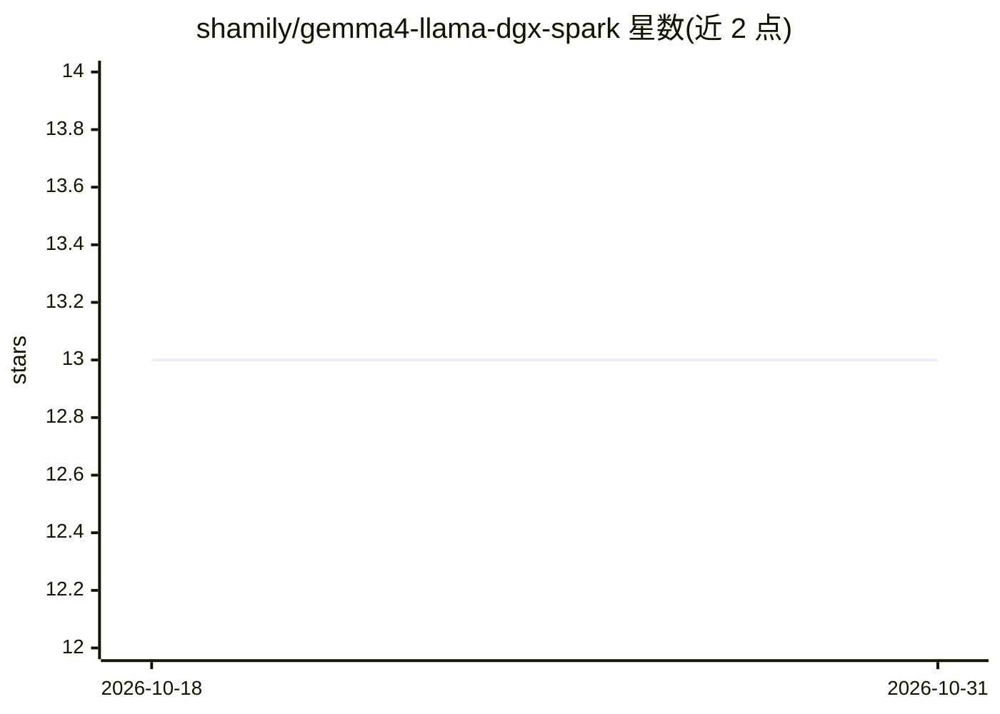

# shamily/gemma4-llama-dgx-spark

⭐ 13 · Shell · MIT · 推送 2026-06-20 · [GitHub](https://github.com/shamily/gemma4-llama-dgx-spark) · 个人维护

**NVIDIA DGX Spark 上量化 Gemma 4 的 Docker 推理服务与基准测试套件**

面向 ASUS Ascent GX10 / NVIDIA DGX Spark（GB10 Grace Blackwell，ARM64）的仓库：以 Docker 容器从源码编译 llama.cpp，运行 Google Gemma 4 四个量化模型（E2B/E4B/26B MoE/31B），经 OpenAI 兼容 API 在 localhost:8080 提供服务；含三组基准（单序列吞吐、上下文深度扫描、批量并发）与思维链计时脚本。构建时锁定 llama.cpp commit 以保证结果可复现。需 Docker Compose、nvidia-container-toolkit 与 NVIDIA 驱动 580+，全四模型约需 60 GB 磁盘。

## 筛选速览

| 维度 | 判定 | 备注 |
|---|---|---|
| AI 角色 | `ai-ecosystem` | LLM/agent 周边工具 |
| 许可风险 | `permissive` | MIT |
| 部署形态 | `self-host` | docker 或自建部署 |
| 模型依赖 | local-ok | 支持本地模型 |
| 硬件要求 | `gpu-24g` | |
| 安装摩擦 | `low` | 无编译、无系统依赖或容器化 |
| 成熟度 | — | 结构信号不足 |

## 能力要点

- 在 GB10（SM_121）上编译 llama.cpp 并提供 OpenAI 兼容 API 服务
- 覆盖 Gemma 4 全部四个量化模型（含 26B MoE 与 31B）
- 三组基准：单序列吞吐、上下文深度扫描、批量并发，附思维链计时脚本
- 锁定 llama.cpp commit 5d3a4a7 以复现基准数字

## 适用场景

- 在 DGX Spark 上本地部署 Gemma 4 并用 OpenAI SDK 访问
- 测量 128 GB 统一内存设备上各尺寸模型的吞吐与延迟
- 对比 MoE 与 dense 模型的生成速度及思维链开销

## 场景标签

`推理引擎` `模型评测` · 领域:评测与运维

## 证据(README 行号)

> L3: Running all four **Google Gemma 4** models with llama.cpp on the NVIDIA GB10 Grace Blackwell SoC, served via a Docke
> L5: > **Hardware-specific:** This repo targets the ASUS Ascent GX10 / NVIDIA DGX Spark (same device, two names). The ARM

## 星数曲线

2026-10-18 13 → 2026-10-31 13（+0）

---
*卡片 v1 · prompt 1.4 · 生成 2026-10-31 · 置信度 mid · 依据 README sha `c98bef1fed4b` · [字段定义](../../DATASET.md)*
