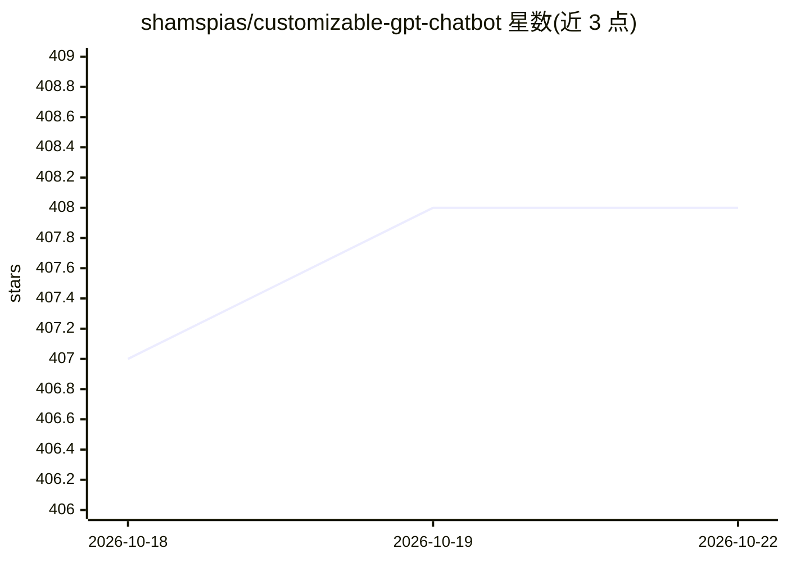

# shamspias/customizable-gpt-chatbot

⭐ 408 · Python · 推送 2026-06-18 · [GitHub](https://github.com/shamspias/customizable-gpt-chatbot) · 个人维护

**本地优先的可自托管 agent 平台：自然语言构建并运行智能体**

自托管、本地优先的 agent-harness 平台：用户用自然语言描述需求，系统将其编译为版本化的 AgentSpec（策略、工具、技能、RAG 知识库、推理方法、团队），运行时是该 spec 的解释器，修改通过可审批的 JSON-Patch 完成。面向需要自建智能体工作区的开发者和团队，提供 Vue 3 前端 + 单一 FastAPI 进程、安装向导、多用户角色、MCP 连接器、可视化工作流构建器与 CLI。LLM 层可插拔，默认 Ollama 本地模型，支持 OpenAI 兼容接口与 Anthropic；针对 sub-1B 本地模型使用受约束的 decision loop 替代原生 tool-calling。Agent 可从反馈中积累 lesson 实现自我改进。部署依赖 Docker 与 Postgres/pgvector、Redis、MinIO 等组件。

## 筛选速览

| 维度 | 判定 | 备注 |
|---|---|---|
| AI 角色 | `ai-ecosystem` | LLM/agent 周边工具 |
| 许可风险 | `none` | — |
| 部署形态 | `self-host` | docker 或自建部署 |
| 模型依赖 | local-ok | 支持本地模型 |
| 硬件要求 | — | 无带数字的原话,不猜 |
| 安装摩擦 | `low` | 无编译、无系统依赖或容器化 |
| 成熟度 | — | 结构信号不足 |

## 能力要点

- 自然语言编译为版本化 AgentSpec，agent 是数据而非代码
- MCP 连接器（Shopify/Alibaba/自定义 HTTP/SSE/stdio）与内置工具目录
- 可编辑知识库：PDF/markdown/网页索引，pgvector/Qdrant，引用带页码
- 针对小模型的约束 decision loop：评测套件报告 0 幻觉工具调用

## 适用场景

- 用对话快速搭建带工具和知识库的问答/业务 agent
- 为在线商店等场景编排多 agent 协作团队
- 自托管搭建团队共享的 agent 工作区并按角色授权

## 场景标签

 · 领域:LLM 应用/Agent 基础设施

## 证据(README 行号)

> L5: **A self-hostable, local-first agent-harness platform.** Describe what you need in
> L22: > `AgentSpec` row in Postgres. "Build me an agent" = compile natural language →
> L23: > validated `AgentSpec`. "Change it" = a JSON-Patch you approve. The runtime is a

## 星数曲线

2026-10-18 407 → 2026-10-22 408（+1）

---
*卡片 v1 · prompt 1.4 · 生成 2026-10-21 · 置信度 mid · 依据 README sha `565fa3fda893` · [字段定义](../../DATASET.md)*
