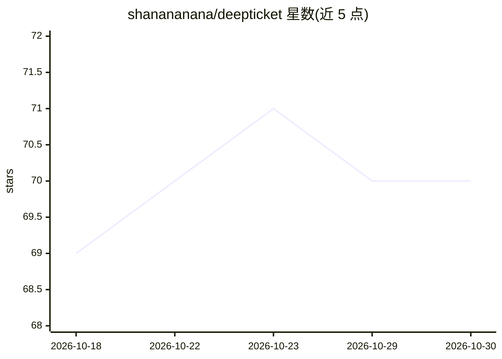

# shanananana/deepticket

⭐ 70 · Python · MIT · 推送 2026-09-14 · [GitHub](https://github.com/shanananana/deepticket) · 个人维护 · 中文 README

**自托管 AI 工单分诊与 Agent 编排平台，连接内部系统做首轮排查**

部署在自有环境的工单分诊平台：通过统一 HTTP Ingress API 与 Webhook 接入内部工单、告警、监控系统，按项目路由到 Git 仓库、日志查询 Skill、配置中心 MCP 等工具，由 OpenHands Agent 执行多轮分析，产出带证据的结论、影响与建议并回写源系统。提供 Web 工作台供产品、运维、客服与工程团队协作，含多项目隔离、异步队列、运行可观测性。不内置厂商专属适配器，当前为 Alpha v0.5.1，MIT 许可。

## 筛选速览

| 维度 | 判定 | 备注 |
|---|---|---|
| AI 角色 | `ai-ecosystem` | LLM/agent 周边工具 |
| 许可风险 | `permissive` | MIT |
| 部署形态 | `self-host` | docker 或自建部署 |
| 模型依赖 | — | README 未给出锁定关系 |
| 硬件要求 | — | 无带数字的原话,不猜 |
| 安装摩擦 | `low` | 无编译、无系统依赖或容器化 |
| 成熟度 | `idea` | |

## 能力要点

- HTTP API / Webhook 通用接入，事件进入后由 Agent 完成多轮分析并回写
- Git 知识同步、日志/配置查询（Skill 模板或 MCP）、多项目隔离
- 证据优先：结论引用源码路径、日志片段与配置键，缺失证据时明示
- Docker Compose 一键部署（Web + OpenHands Agent Server + Redis）

## 适用场景

- 值班告警进来后先做一轮自动化事实核查再决定是否升级
- 客服/运维/产品在统一工作台里共同核查'是 bug 还是配置问题'
- 把工单系统接入 Agent，自动写回带证据的初步分诊结论

## 场景标签

`Agent 框架` · 领域:Agent 开发

## 证据(README 行号)

> L40: DeepTicket is a **self-hosted AI ticket triage and Agent orchestration platform** deployed in your own environment.
> L130: **Relationship to OpenHands:** OpenHands runs the Agent; DeepTicket provides the workbench, project config, knowle

## 星数曲线

2026-10-18 69 → 2026-10-30 70（+1）

---
*卡片 v1 · prompt 1.4 · 生成 2026-10-24 · 置信度 mid · 依据 README sha `70a7daa3bb1d` · [字段定义](../../DATASET.md)*
