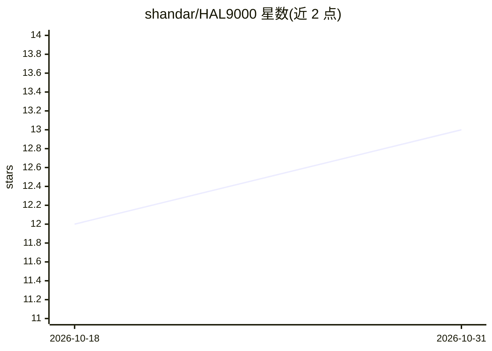

# shandar/HAL9000

⭐ 13 · Python · MIT · 推送 2026-03-20 · [GitHub](https://github.com/shandar/HAL9000) · [官网](https://affordance.design/hal9000/) · 个人维护

**本地多模态 AI agent：看听说思考并操控你的电脑**

运行于本机的多模态 AI agent，通过摄像头看、麦克风听（Whisper/faster-whisper STT）、多供应商 LLM 思考（GPT-4o/Claude/Gemini/Ollama，支持函数调用）、TTS 说话（Edge/ElevenLabs/XTTS），并以 43 个跨平台工具操控系统（shell、应用、文件、剪贴板等）。提供浏览器控制面板与 MCP server，可作为 Claude Code 的协作中枢（后台任务、多 agent 编排、上下文交接）。支持 FREE_MODE 全本地零 API key 运行。跨 macOS/Windows/Linux，git clone 源码 + Python venv 运行。

## 筛选速览

| 维度 | 判定 | 备注 |
|---|---|---|
| AI 角色 | `ai-native` | 本体是模型或模型工具 |
| 许可风险 | `permissive` | MIT |
| 部署形态 | `library` | 以包/库形式分发 |
| 模型依赖 | local-ok | 支持本地模型 |
| 硬件要求 | — | 无带数字的原话,不猜 |
| 安装摩擦 | `medium` | 含编译或系统依赖之一 |
| 成熟度 | — | 结构信号不足 |

## 能力要点

- 43 个跨平台系统操控工具与 35 个斜杠命令
- FREE_MODE 一键切换全本地运行（Ollama + faster-whisper + Edge TTS）
- MCP server 暴露 21 个工具供 Claude Code 双向协作
- 带类型持久记忆、知识上传（BM25 检索）与多 agent 编排

## 适用场景

- 用语音与摄像头让 AI 在本机代为执行操作
- 零 API key 全本地跑一个能看能听能说的 agent
- 作为 Claude Code 的协作中枢提交后台任务和多 agent 并行工作

## 场景标签

`多智能体` `语音 Agent` `多模态` `GUI 自动化` · 领域:Agent 开发

## 证据(README 行号)

> L7:  Local, multimodal AI agent — sees, hears, thinks, speaks, and acts on your machine.
> L16: A local, multimodal AI agent that **sees** you via webcam, **hears** your voice, **thinks** via LLM, **speaks** wit
> L26: |**Think**|Multi-provider LLM (GPT-4o, Claude, Gemini, **Ollama**) with function calling|

## 星数曲线

2026-10-18 12 → 2026-10-31 13（+1）

---
*卡片 v1 · prompt 1.4 · 生成 2026-10-31 · 置信度 mid · 依据 README sha `b16a41eb5744` · [字段定义](../../DATASET.md)*
