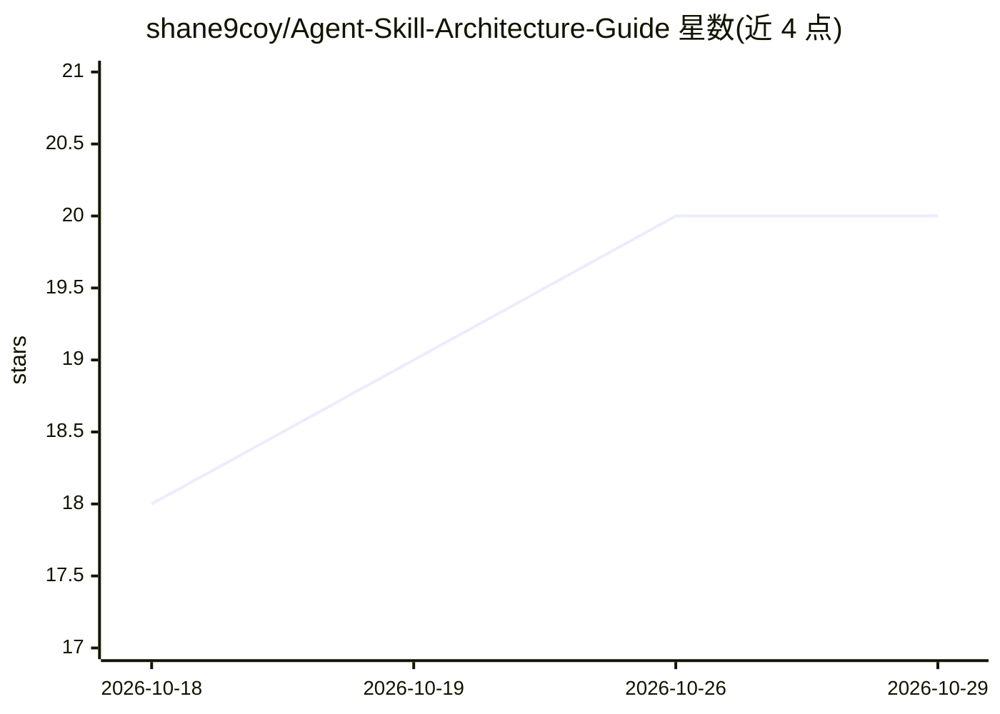

# shane9coy/Agent-Skill-Architecture-Guide

⭐ 20 · MIT · 推送 2026-06-15 · [GitHub](https://github.com/shane9coy/Agent-Skill-Architecture-Guide) · [官网](https://www.katana-agent.com) · 个人维护

**面向编码代理的技能与指令模板指南：AGENTS.md 与 SKILL.md 组织规范**

提供 AGENTS.md 全局指令模板与三个可复用 agent 技能（agent-copy 用于把全局指令复制进项目仓库，new-skill-builder 用于创建/校验技能，new-mcp-builder 用于规划 MCP 服务集成），并附 Markdown/PDF 版架构指南，覆盖 SKILL.md 结构、frontmatter、渐进披露与编排目录等概念。安装方式为 git clone 后将文件复制到 ~/.codex 等各代理对应目录。兼容 OpenAI Codex、Claude Code、KiloCode、Cursor、Windsurf 等多种编码代理，附目录映射表。MIT 许可。

## 筛选速览

| 维度 | 判定 | 备注 |
|---|---|---|
| AI 角色 | `ai-knowledge` | 知识聚合/清单类 |
| 许可风险 | `permissive` | MIT |
| 部署形态 | `None` |  |
| 模型依赖 | — | README 未给出锁定关系 |
| 硬件要求 | — | 无带数字的原话,不猜 |
| 安装摩擦 | `low` | 无编译、无系统依赖或容器化 |
| 成熟度 | — | 结构信号不足 |

## 能力要点

- AGENTS.md 模板覆盖 Git 卫生、上下文编辑、评审与交接纪律
- 三个可复用技能：agent-copy / new-skill-builder / new-mcp-builder
- SKILL.md 规范：YAML frontmatter + 渐进披露 + references/ 目录
- 兼容表覆盖 Codex、Claude Code、KiloCode、OpenCode、Cursor 等 7+ 代理

## 适用场景

- 为我的编码代理统一安装全局行为指令
- 让代理自动在项目仓库生成本地 AGENTS.md
- 按规范创建和校验新的 agent 技能与 MCP 集成

## 场景标签

`提示工程` · 领域:Agent 开发

## 证据(README 行号)

> L9: The guide covers agent folder structure, `AGENTS.md`, `SKILL.md` anatomy, frontmatter reference, orchestration folde
> L26: - `AGENTS.md`: public template for agent behavior, Git hygiene, contextual editing, implementation review, and hand
> L163: - **`AGENTS.md`**: Durable agent instructions for behavior, Git hygiene, contextual editing, stack conventions, ve

## 星数曲线

2026-10-18 18 → 2026-10-29 20（+2）

---
*卡片 v1 · prompt 1.4 · 生成 2026-10-28 · 置信度 high · 依据 README sha `1e4ac1406405` · [字段定义](../../DATASET.md)*
