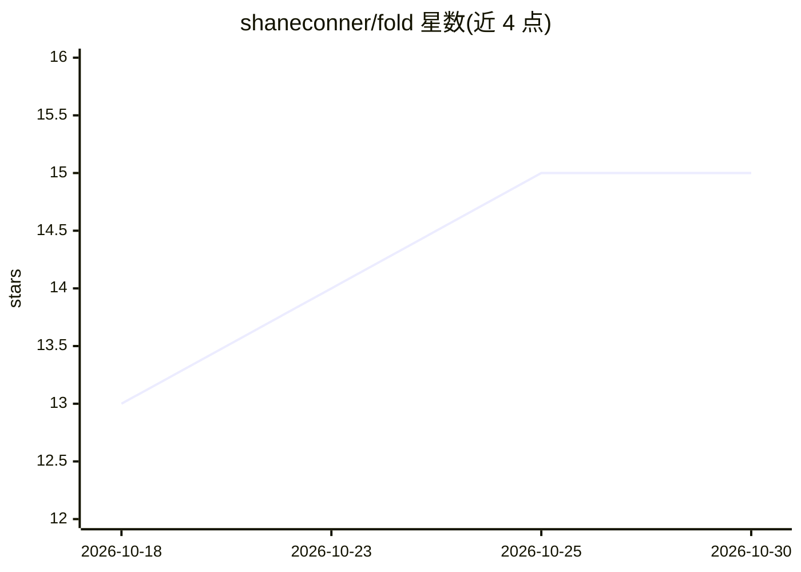

# shaneconner/fold

⭐ 15 · JavaScript · MIT · 推送 2026-10-26 · [GitHub](https://github.com/shaneconner/fold) · [官网](https://shaneconner.com/projects/pi-fold/) · 个人维护

**Pi 编码代理的无损上下文折叠插件：旧上下文换摘要原文留盘**

面向 Pi 编码代理的 npm 包（pi 包格式），在长会话中把陈旧上下文折叠为简报而保留磁盘上的原始消息：完成的工具批次被标记为候选，窗口达到阈值时一次性提交折叠，保持前缀缓存命中；代理可通过 peek/expand 取回经哈希校验的原文。提供 /fold-status、/fold-editor 等命令、折叠用量条与 JSON 配置。要求 Node 22+ 与 Pi 0.83+，MIT 许可；README 给出 64 阶段编码任务上的召回/成本/耗时对比数据。

## 筛选速览

| 维度 | 判定 | 备注 |
|---|---|---|
| AI 角色 | `ai-ecosystem` | LLM/agent 周边工具 |
| 许可风险 | `permissive` | MIT |
| 部署形态 | `None` |  |
| 模型依赖 | — | README 未给出锁定关系 |
| 硬件要求 | — | 无带数字的原话,不猜 |
| 安装摩擦 | `low` | 无编译、无系统依赖或容器化 |
| 成熟度 | — | 结构信号不足 |

## 能力要点

- 标记-提交机制：仅在提交时重写窗口，其余为纯追加，保持前缀缓存
- 无损召回：每条简报哈希链接原始消息，可 peek 单轮查看或 expand 原位恢复
- 折叠过程自动运行，无需代理调用工具；Pi 自带 compaction 仍保留为逃生通道
- 可配置折叠阈值、工具黑名单、前缀通知与折叠条配色

## 适用场景

- 长时间编码会话中控制上下文窗口占用而不丢信息
- 降低长会话的 API 成本并保持前缀缓存命中
- 需要回查已折叠历史消息原文的场景

## 场景标签

 · 领域:LLM 代理/上下文工程

## 证据(README 行号)

> L5: **Long sessions without forgetting.** pi-fold rotates stale context out of the window and into short briefs, while t
> L12: pi install npm:pi-fold
> L56: The agent gets one tool, `pi_fold_context`, with actions to `status`, `peek`, `expand`, `refold`, `pin` and `unpin`

## 星数曲线

2026-10-18 13 → 2026-10-30 15（+2）

---
*卡片 v1 · prompt 1.4 · 生成 2026-10-30 · 置信度 high · 依据 README sha `ac34172b265a` · [字段定义](../../DATASET.md)*
