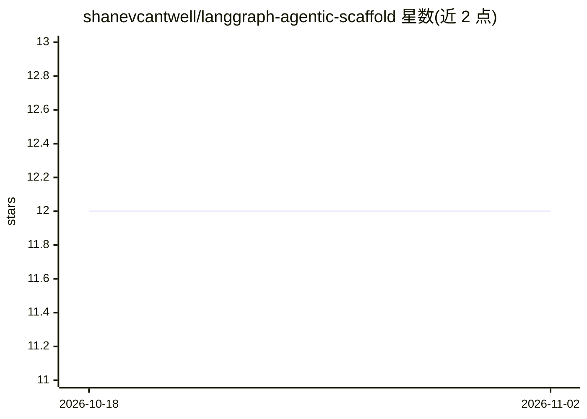

# shanevcantwell/langgraph-agentic-scaffold

⭐ 12 · Python · 推送 2026-09-19 · [GitHub](https://github.com/shanevcantwell/langgraph-agentic-scaffold) · 个人维护

**个人研究型 LangGraph 多模型 agent 编排脚手架**

基于 LangGraph 的多模型 agent 编排框架：通过语义路由将请求分派给各专职 specialist（每个可绑定不同 LLM），以 Triage 成本门控、Systems Architect 规划、Facilitator 上下文注入、受治理的终止流程与结构化安全约束（specialist 无法单方面终止或绕过控制面）组织执行。支持 delegate() 子任务派生、驻留检测、MCP 集成与本地推理端点（LM Studio / llama-server）及 Gemini。以个人研究项目形式开发，声明为 alpha 阶段、版本间可能有破坏性变更；推荐 Docker 部署并要求沙箱环境运行。

## 筛选速览

| 维度 | 判定 | 备注 |
|---|---|---|
| AI 角色 | `ai-ecosystem` | LLM/agent 周边工具 |
| 许可风险 | `permissive` | — |
| 部署形态 | `self-host` | docker 或自建部署 |
| 模型依赖 | — | README 未给出锁定关系 |
| 硬件要求 | — | 无带数字的原话,不猜 |
| 安装摩擦 | `low` | 无编译、无系统依赖或容器化 |
| 成熟度 | `idea` | |

## 能力要点

- 语义路由的多模型编排，模型角色经 user_settings.yaml 运行时配置
- 四阶段受治理终止流程与结构化安全约束
- delegate() 上下文隔离子任务与驻留检测
- 输出 OpenAI 兼容 /v1/chat/completions 端点，暴露完整编排管线

## 适用场景

- 构建带安全约束的多模型 agent 工作流
- 研究编排层干预对模型行为的影响（不改动权重）
- 通过任意 OpenAI 协议客户端接入完整编排管线

## 场景标签

`Agent 框架` `多智能体` · 领域:Agent 开发

## 证据(README 行号)

> L15: LAS is a personal research project that orchestrates multi-model agentic workflows through LangGraph. It routes use
> L73: Adapters for local inference (LM Studio / llama-server) and Gemini. Named server references support distributed inf

## 星数曲线

2026-10-18 12 → 2026-11-02 12（+0）

---
*卡片 v1 · prompt 1.4 · 生成 2026-11-01 · 置信度 high · 依据 README sha `7a8da0149ea9` · [字段定义](../../DATASET.md)*
