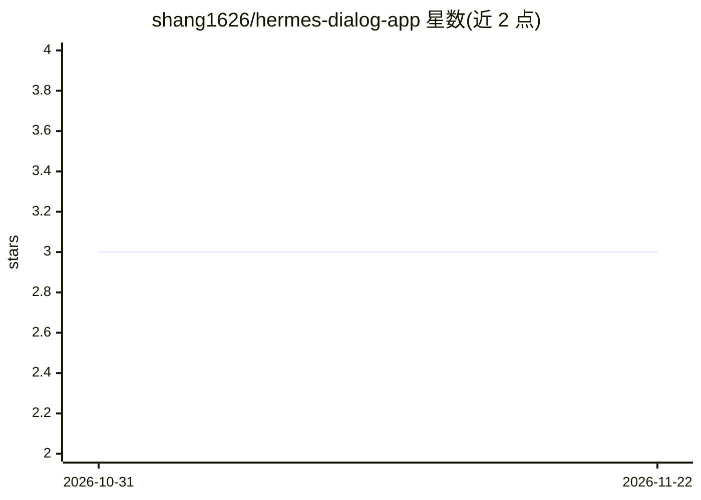

# shang1626/hermes-dialog-app

⭐ 3 · Kotlin · MIT · 推送 2026-11-08 · [GitHub](https://github.com/shang1626/hermes-dialog-app) · 个人维护 · 中文 README

**自托管安卓客户端：连接自建 Hermes Agent 网关与 AI 助手对话**

纯客户端 Kotlin + Jetpack Compose 工程，不含服务端代码；连接用户自建的 Hermes 网关 api_server 平台。功能覆盖 SSE 流式对话、多会话管理、双 Profile 切换、token 用量与子任务进度可视化、图片/文件收发、语音播报（服务端 TTS）、应用内 APK 更新与本地持久化。需自行部署 Hermes 网关作为服务端；构建需 JDK 17+ 与 Android SDK，无 gradle wrapper，提供 build.sh 一键构建脚本与国内镜像依赖配置。

## 筛选速览

| 维度 | 判定 | 备注 |
|---|---|---|
| AI 角色 | `ai-native` | 本体是模型或模型工具 |
| 许可风险 | `permissive` | MIT |
| 部署形态 | `None` |  |
| 模型依赖 | — | README 未给出锁定关系 |
| 硬件要求 | — | 无带数字的原话,不猜 |
| 安装摩擦 | `medium` | 含编译或系统依赖之一 |
| 成熟度 | — | 结构信号不足 |

## 能力要点

- SSE 流式对话、中途插话（steering）与断线续接 run
- 双 Profile 独立账号与会话存储，账号密码即令牌、包内零密钥
- 实时 token 用量、子代理步骤流水与网关状态页（5 秒刷新）
- 提供 build.sh 工具链自动探测与编译踩坑排查文档

## 适用场景

- 在手机上与自建 Hermes Agent 对话并追踪长任务进度
- 外网通过反向代理安全访问家中网关
- 多账号/多机器人身份隔离使用
- 需要应用内自更新分发的私有部署场景

## 场景标签

`AI 助手` `聊天机器人` · 领域:对话与助手

## 证据(README 行号)

> L7: 一个自托管的安卓客户端，连接你自己搭建的 Hermes Agent 网关，在手机上跟 AI 助手对话。
> L73: 核心数据流（一次对话 = 一次 run，全部推理在服务端）：
> L99: 服务端要求：Hermes 网关（自带 `api_server` 平台），默认监听 `127.0.0.1:8642`。

## 星数曲线

2026-10-31 3 → 2026-11-22 3（+0）

---
*卡片 v1 · prompt 1.4 · 生成 2026-11-21 · 置信度 high · 依据 README sha `681f8a624236` · [字段定义](../../DATASET.md)*
