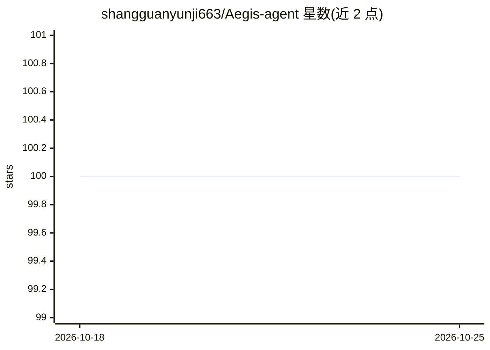

# shangguanyunji663/Aegis-agent

⭐ 100 · Python · MIT · 推送 2026-10-11 · [GitHub](https://github.com/shangguanyunji663/Aegis-agent) · 个人维护 · 中文 README

**校园心理支持多 Agent 平台：学生倾诉、风险识别与管理端干预闭环**

面向校园心理支持场景的多 Agent 平台，含学生端对话、心理知识 RAG 检索、风险识别与管理端处置工作台。后端以 FastAPI + Agent Runtime Harness 统一处理意图路由、分层记忆注入、工具治理（ToolJob 审批与审计）与 trace 落库；多 Agent 协作基于 append-only blackboard，可切换 LangGraph 或 ordered 运行时。风险判定采用规则与 QLoRA/通用 LLM 双通道取并集。默认 SQLite + mock 提供零密钥启动，声明不提供医学诊断、不等同临床有效性评估。

## 筛选速览

| 维度 | 判定 | 备注 |
|---|---|---|
| AI 角色 | `ai-native` | 本体是模型或模型工具 |
| 许可风险 | `permissive` | MIT |
| 部署形态 | `desktop` | 安装包/桌面程序 |
| 模型依赖 | local-ok | 支持本地模型 |
| 硬件要求 | — | 无带数字的原话,不猜 |
| 安装摩擦 | `low` | 无编译、无系统依赖或容器化 |
| 成熟度 | — | 结构信号不足 |

## 能力要点

- 学生端与管理端双信息架构，含风险报告、个案、trace 与工具审计
- 意图路由控制是否触发 RAG，多路召回 + 三引擎精排
- 工具调用生成 ToolJob 经角色/风险/审批/脱敏/审计后入队，支持 FastMCP 后端
- 风险规则 ∪ QLoRA/通用 LLM 双通道，任一判高危即高危并规则兜底

## 适用场景

- 学生通过对话获得即时情绪支持与风险安全回应
- 辅导员与管理员查看风险报告、处置个案并审计工具执行
- 运行校园心理知识检索与人工标注金标集评测

## 场景标签

`多智能体` `RAG` `聊天机器人` · 领域:Agent 开发

## 证据(README 行号)

> L26: `Aegis Psych Agent` 是一个校园心理支持多 Agent 平台，围绕**学生端倾诉**、**心理知识检索**、**风险识别**、**辅导员工作台**和**高风险工具执行闭环**五个环节展开。
> L28: 它不是一个简单的聊天机器人，而是将「学生侧即时支持」与「管理侧可审计干预」拆分为两套独立信息架构，并通过统一的后端 Agent Runtime Harness 处理意图路由、记忆注入、RAG 检索、风险报告、trace 落库与工具

## 星数曲线

2026-10-18 100 → 2026-10-25 100（+0）

---
*卡片 v1 · prompt 1.4 · 生成 2026-10-23 · 置信度 high · 依据 README sha `4983d5395ed4` · [字段定义](../../DATASET.md)*
